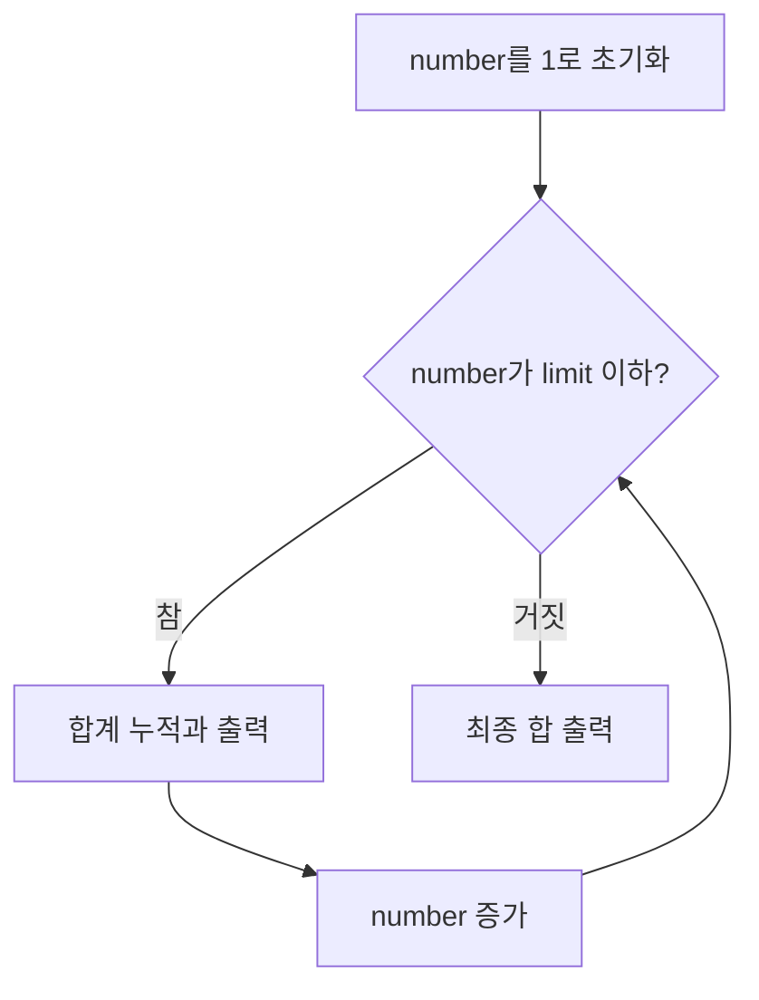

# 03. 조건문과 반복문

| 난이도 | 선수 학습 | 준비물 |
| --- | --- | --- |
| 입문 | [02. 변수·상수·자료형·연산자](../02-variables-types/README.md) | Go, 편집기, 터미널, 이 저장소 |

02장에서는 비교식으로 `true`와 `false`를 만들었습니다. 이제 그 결과에 따라 서로 다른 문장을 실행하고, 같은 계산을 여러 번 반복해 봅니다. 점수에 따라 안내를 바꾸거나, 1부터 5까지의 합을 구하는 프로그램을 직접 작성합니다.

**제어 흐름(control flow)**은 프로그램이 어떤 문장을 어떤 순서로 실행하는지를 뜻합니다. 이번 장의 핵심은 조건을 읽을 때 **어느 경로를 선택하는지**, 반복을 읽을 때 **어떤 값이 바뀌고 언제 끝나는지**를 설명하는 것입니다.

## 학습 목표

이 장을 마치면 다음을 할 수 있습니다.

- `if`, `else if`, `else`로 조건에 맞는 경로를 선택하고 경계값을 확인한다.
- 값이 정해진 선택과 여러 조건의 선택을 `switch`로 표현한다.
- `for`의 초기화·조건·반복 후 문장과 조건만 있는 반복을 따라 설명한다.
- 정수 `range`, `break`, `continue`를 사용해 반복 횟수와 처리 대상을 제어한다.
- 반복 횟수 오류, 끝나지 않는 반복, 변수의 사용 범위 때문에 생긴 오류를 찾아 고친다.

## 사전 지식과 준비

변수 선언과 대입, `int`·`string`·`bool`, `%`, 비교 연산자, `&&`·`||`·`!`, `fmt.Println`·`fmt.Printf`를 사용합니다. 계산이 낯설다면 [02장](../02-variables-types/README.md)을 먼저 마칩니다. 입력값은 코드 안의 변수로 정합니다. 배열·슬라이스, 사용자 정의 함수, 키보드 입력은 기본 과정에 필요하지 않습니다.

모든 명령은 **저장소 루트 `GoLang_all_in_one/`**에서 실행합니다. Go 명령은 Windows PowerShell과 macOS·Linux·WSL에서 같습니다. 개인 파일을 준비하는 명령만 운영체제별로 구분합니다. 하위 폴더에 새 `go.mod`나 `go.work`를 만들지 않습니다.

정수에 대한 `range`는 **Go 1.22부터** 지원합니다. 이 저장소는 [`go.mod`](../../go.mod)의 Go 1.27 계열을 사용하므로 그대로 실행할 수 있습니다. [Go 1.22 언어 변경 사항](https://go.dev/doc/go1.22#language)을 참고합니다.

| 실행 예제 | 학습할 내용 | 실행 명령 |
| --- | --- | --- |
| [conditions](../../examples/03-control-flow/conditions/main.go) | 순서가 있는 조건 분기 | `go run ./examples/03-control-flow/conditions` |
| [switch](../../examples/03-control-flow/switch/main.go) | 같은 처리를 할 여러 값 묶기 | `go run ./examples/03-control-flow/switch` |
| [for-sum](../../examples/03-control-flow/for-sum/main.go) | 반복하면서 합계 누적 | `go run ./examples/03-control-flow/for-sum` |
| [countdown](../../examples/03-control-flow/countdown/main.go) | 조건이 참인 동안 반복 | `go run ./examples/03-control-flow/countdown` |
| [loop-control](../../examples/03-control-flow/loop-control/main.go) | 중단과 건너뛰기 | `go run ./examples/03-control-flow/loop-control` |
| [range-count](../../examples/03-control-flow/range-count/main.go) | 정해진 횟수만큼 반복 | `go run ./examples/03-control-flow/range-count` |
| [nested](../../examples/03-control-flow/nested/main.go) | 바깥 반복과 안쪽 반복 | `go run ./examples/03-control-flow/nested` |

본문에서 **발췌**라고 표시한 Go 블록은 `main` 함수 안에 넣는 코드입니다. 각 발췌는 서로 독립적이며, 한 파일에 모두 이어 붙이지 않습니다. 실행하려면 `package main`, `import "fmt"`, `func main()`을 포함한 파일을 사용합니다. 9절에서 준비할 개인 파일 `_practice/03-control-flow/lab/main.go`에 기존 내용을 보관한 뒤 하나씩 넣어 확인할 수 있습니다.

## 1. `if`로 실행할 코드 선택하기

### 1.1 점수에 따라 다른 문장 출력하기

**조건문(conditional statement)**은 조건의 참·거짓에 따라 실행할 코드를 고릅니다. 아래 예제에서는 0부터 100 사이의 점수를 입력한다고 가정하고, 80점 이상이면 `우수`, 60점 이상이면 `통과`, 나머지는 `다시 연습`을 출력합니다. 범위를 벗어난 점수까지 처리하는 연습은 연습문제 2에서 합니다.

저장 경로: [`examples/03-control-flow/conditions/main.go`](../../examples/03-control-flow/conditions/main.go).

```go
package main

import "fmt"

func main() {
	score := 72

	if score >= 80 {
		fmt.Println("우수")
	} else if score >= 60 {
		fmt.Println("통과")
	} else {
		fmt.Println("다시 연습")
	}
	fmt.Println("판정 완료")
}
```

실행:

```sh
go run ./examples/03-control-flow/conditions
```

예상 출력:

```text
통과
판정 완료
```

`score >= 80`은 거짓이므로 첫 블록을 건너뜁니다. 이어서 `score >= 60`이 참이므로 `통과`를 출력합니다. 같은 연결 안의 나머지 `else`는 실행하지 않고 조건문 뒤의 `판정 완료`로 이어집니다.

중괄호 `{ ... }`로 묶은 문장들의 영역을 **블록(block)**이라고 합니다. 들여쓰기는 읽기 쉽게 해 주고, 실제 묶음은 중괄호가 정합니다. `if`의 조건은 불리언 값이어야 하며, 조건 주변에 괄호를 붙일 필요는 없습니다. 실행할 문장이 한 줄이어도 중괄호를 씁니다. [if 문](https://go.dev/ref/spec#If_statements)과 [블록](https://go.dev/ref/spec#Blocks)의 규칙입니다.

### 1.2 `else`가 없으면 어떻게 될까?

다음은 `main` 안의 발췌입니다.

```go
ready := false
if ready {
	fmt.Println("학습 시작")
}
fmt.Println("준비 확인 완료")
```

출력은 `준비 확인 완료` 한 줄입니다. 조건이 거짓이면 블록을 건너뛰고 다음 문장을 실행합니다. `else`는 반드시 필요한 문법이 아닙니다. 이미 `bool`인 변수는 `if ready`처럼 사용할 수 있고, 반대 조건은 `if !ready`로 적을 수 있습니다.

Go에서는 정수나 문자열을 자동으로 참·거짓으로 해석하지 않습니다. 개수가 양수인지를 확인하려면 `if count > 0`, 문자열이 비어 있지 않은지를 확인하려면 `if title != ""`처럼 조건을 명시합니다.

### 1.3 조건의 순서와 경계값

첫 예제에서 80점 기준을 먼저 검사한 이유는 80점 이상인 값이 60점 이상이라는 조건도 만족하기 때문입니다. `score >= 60`을 먼저 쓰면 92점도 그 경로에서 선택되어 뒤의 우수 판정까지 가지 않습니다.

| `score` | 첫 번째 참인 조건 | 첫 줄 출력 |
| --- | --- | --- |
| `59` | 없음 | `다시 연습` |
| `60` | `score >= 60` | `통과` |
| `79` | `score >= 60` | `통과` |
| `80` | `score >= 80` | `우수` |
| `100` | `score >= 80` | `우수` |

`>`와 `>=`의 차이는 경계에 있는 값에서 드러납니다. 기준이 60점 이상이라면 59·60·61점을 각각 확인합니다. **경계값(boundary value)**은 이처럼 판단이 달라지는 지점과 그 주변의 값입니다.

연결된 `if`·`else if`와 독립된 `if`는 다릅니다. 다음 발췌를 읽어 보세요.

```go
score := 92
if score >= 60 {
	fmt.Println("통과")
}
if score >= 80 {
	fmt.Println("우수")
}
```

이 코드는 `통과`, `우수`를 각각 한 줄씩 출력합니다. 두 조건문이 독립적으로 실행되기 때문입니다. 여러 안내가 동시에 필요하면 독립된 조건문을, 하나의 등급을 선택하려면 연결된 조건문을 사용할 수 있습니다.

## 2. 조건에 필요한 값과 사용 범위

### 2.1 여러 조건을 조합하기

02장의 논리 연산자를 조건문에 그대로 사용할 수 있습니다. 다음은 발췌입니다.

```go
score := 72
submitted := true
if score >= 60 && submitted {
	fmt.Println("수료 조건 충족")
} else {
	fmt.Println("점수와 제출 여부 확인")
}
```

출력은 `수료 조건 충족`입니다. 여기서는 점수와 제출 여부를 모두 만족해야 합니다. 둘 중 하나만 만족해도 되는 상황이라면 `||`가 맞는지 검토합니다. 조건을 쓰기 전에 “둘 다 필요한가, 하나면 되는가”를 문장으로 적어 보세요.

입력 범위를 확인할 때는 `score < 0 || score > 100`처럼 범위 바깥을 표현할 수 있습니다. `0 <= score <= 100`처럼 비교를 연달아 적는 방식은 Go에서 사용할 수 없습니다. `score >= 0 && score <= 100`으로 각각의 비교를 연결합니다. [비교 연산자](https://go.dev/ref/spec#Comparison_operators)와 [논리 연산자](https://go.dev/ref/spec#Logical_operators)를 참고합니다.

### 2.2 `if` 앞부분에서 값을 만들기

조건을 판단하는 동안만 사용할 값을 `if`의 앞부분에서 만들 수 있습니다. 다음은 발췌입니다.

```go
if remainder := 17 % 5; remainder == 0 {
	fmt.Println("나누어떨어짐")
} else {
	fmt.Printf("나머지: %d\n", remainder)
}
```

예상 출력:

```text
나머지: 2
```

세미콜론 `;` 앞의 `remainder := 17 % 5`를 먼저 실행하고, 뒤의 `remainder == 0`으로 경로를 선택합니다. 이 형식은 `if 초기화 문장; 조건 { ... }`로 읽으면 됩니다.

이때 `remainder`는 조건식과 이어진 `if`·`else if`·`else` 안에서 사용할 수 있지만, **전체 조건문이 끝난 뒤에는 사용할 수 없습니다.** 이름을 사용할 수 있는 범위를 **스코프(scope)**라고 합니다. 조건문 뒤에 `fmt.Println(remainder)`를 추가하면 이 이름을 찾을 수 없다는 컴파일 오류가 발생합니다. [선언과 스코프](https://go.dev/ref/spec#Declarations_and_scope)를 참고합니다.

조건문이 끝난 다음에도 필요한 값이라면 바깥에서 먼저 선언합니다. 반대로 짧은 판단에만 필요한 이름은 그 판단 가까이에 두면 사용 범위를 좁힐 수 있습니다.

### 2.3 바깥 변수의 값을 바꾸려면 `=`

다음 발췌의 목적은 조건을 만족하면 바깥의 `message`를 바꾸는 것입니다.

```go
message := "계속 연습"
score := 72
if score >= 60 {
	message = "통과"
}
fmt.Println(message)
```

출력은 `통과`입니다. 안쪽에서 `message := "통과"`로 바꾸면 **새로운 안쪽 변수**를 선언하게 됩니다. 이를 바깥 이름을 **가린다(shadowing)**고 합니다. 새 변수를 사용하지 않으면 미사용 변수 오류가 생기고, 안에서 출력해 사용하더라도 바깥 `message`의 값은 바뀌지 않습니다.

02장에서 구분한 선언과 대입을 다시 적용하세요. 기존 값을 갱신하는 의도라면 `=`를 사용합니다. 함수와 더 복잡한 스코프의 관계는 04장에서 이어서 다룹니다.

## 3. `switch`로 여러 선택지 표현하기

### 3.1 하나의 값과 여러 경우 비교하기

요일처럼 정해진 값에 따라 동작을 고를 때는 `switch`로 선택지를 모아 볼 수 있습니다.

저장 경로: [`examples/03-control-flow/switch/main.go`](../../examples/03-control-flow/switch/main.go).

```go
package main

import "fmt"

func main() {
	day := "토"

	switch day {
	case "월", "화", "수", "목", "금":
		fmt.Println("학습하는 날")
	case "토", "일":
		fmt.Println("쉬는 날")
	default:
		fmt.Println("요일 확인")
	}
}
```

실행:

```sh
go run ./examples/03-control-flow/switch
```

예상 출력:

```text
쉬는 날
```

| 부분 | 하는 일 |
| --- | --- |
| `switch day` | 이번 선택에 사용할 `day`의 값을 확인 |
| `case "월", "화", "수", "목", "금":` | 나열한 값 중 하나와 같으면 평일 처리 |
| `case "토", "일":` | 두 값 중 하나와 같으면 휴일 처리 |
| `default:` | 어느 `case`에도 일치하지 않으면 처리 |

하나의 `case`에 여러 값을 쉼표로 나열하면 같은 코드를 공유합니다. `day`를 `"월"`로 바꾸면 `학습하는 날`, `"토요일"`로 바꾸면 `요일 확인`입니다. 문자열은 지정한 값과 정확히 비교하므로, 사람이 같은 뜻으로 읽는 다른 표기가 자동으로 같은 값이 되지는 않습니다.

`switch`의 비교 대상은 한 번 계산하고, `case`는 위에서 아래로, 같은 `case`의 식들은 왼쪽에서 오른쪽으로 확인합니다. 처음 일치하는 경우를 선택합니다. `default`는 일치하는 `case`가 없을 때 사용하며 생략할 수 있습니다. 일치 항목도 `default`도 없으면 `switch` 뒤로 진행합니다. [표현식 switch](https://go.dev/ref/spec#Expression_switches)가 이 동작을 정합니다.

### 3.2 매번 `break`를 쓰지 않아도 된다

일반적인 Go의 `switch`는 선택한 `case`의 실행을 마치면 `switch`를 끝냅니다. 다음 `case`가 자동으로 실행되지 않으므로 매번 끝에 `break`를 넣을 필요가 없습니다.

여러 값에 같은 처리가 필요하면 첫 예제처럼 `case "토", "일":`로 묶습니다. 다른 언어에서 본 `fallthrough` 동작을 기본으로 가정하지 마세요. 명시적으로 다음 절을 실행하는 `fallthrough`는 11절의 선택 학습에서 따로 확인합니다.

### 3.3 비교할 값을 생략한 `switch`

범위처럼 서로 다른 조건을 순서대로 검사할 수도 있습니다. 다음은 발췌입니다.

```go
score := 82
switch {
case score >= 80:
	fmt.Println("우수")
case score >= 60:
	fmt.Println("통과")
default:
	fmt.Println("다시 연습")
}
```

출력은 `우수`입니다. 비교 대상을 생략한 `switch`는 `switch true`처럼 동작하므로 처음 참이 되는 `case`를 선택합니다. 조건이 겹친다면 여전히 순서가 중요합니다. 위의 두 `case`를 바꾸면 82점도 `통과`가 됩니다.

| 판단하려는 내용 | 사용할 수 있는 형태 |
| --- | --- |
| 조건 하나에 따라 실행할지 결정 | `if 조건` |
| 순서가 있는 몇 가지 조건 중 선택 | `if`·`else if` 또는 값 없는 `switch` |
| 같은 변수의 값이 여러 후보 중 무엇인지 선택 | `switch 값` |

어느 문법이 항상 더 좋다는 규칙은 없습니다. 조건과 선택지가 읽히기 쉬운 형태를 고릅니다.

## 4. `for`로 합계 누적하기

### 4.1 반복문을 이루는 세 부분

**반복문(loop)**은 같은 블록을 여러 번 실행합니다. 1부터 5까지 더하려면 `1 + 2 + 3 + 4 + 5`를 적을 수도 있지만, 마지막 숫자가 달라질 때마다 식을 다시 작성해야 합니다. 반복문은 현재 숫자를 바꾸면서 같은 덧셈을 수행합니다.

저장 경로: [`examples/03-control-flow/for-sum/main.go`](../../examples/03-control-flow/for-sum/main.go).

```go
package main

import "fmt"

func main() {
	limit := 5
	total := 0

	for number := 1; number <= limit; number++ {
		total += number
		fmt.Printf("%d까지의 합: %d\n", number, total)
	}
	fmt.Printf("최종 합: %d\n", total)
}
```

실행:

```sh
go run ./examples/03-control-flow/for-sum
```

예상 출력:

```text
1까지의 합: 1
2까지의 합: 3
3까지의 합: 6
4까지의 합: 10
5까지의 합: 15
최종 합: 15
```

| 부분 | 예제 | 실행 시점 |
| --- | --- | --- |
| 초기화 문장(init) | `number := 1` | 첫 조건 확인 전에 한 번 |
| 조건(condition) | `number <= limit` | 본문을 실행하기 전마다 |
| 반복 후 문장(post) | `number++` | 본문을 마친 뒤 다음 조건 확인 전 |
| 반복 본문(body) | 합계 변경과 출력 | 조건이 참인 경우 |

초기화·조건·반복 후 문장은 세미콜론 두 개로 구분합니다. 전체를 `for 초기화; 조건; 반복 후 문장 { 본문 }`으로 읽습니다. 다음 그림은 중간에 `break`나 `continue`가 없는 이 예제의 흐름입니다.



조건은 처음에도 검사합니다. 처음부터 거짓이면 본문과 반복 후 문장은 한 번도 실행하지 않습니다. 반복 후 문장에는 `number++`나 대입문을 쓸 수 있지만 `:=`로 새 변수를 선언할 수는 없습니다. [for 절의 규칙](https://go.dev/ref/spec#For_clause)을 참고합니다.

### 4.2 한 번씩 값을 추적하기

한 차례 반복하는 것을 **반복 회차(iteration)**라고 부릅니다. 각 회차의 값을 기록하면 합계와 조건을 함께 확인할 수 있습니다.

| 조건을 확인할 때의 `number` | 조건 결과 | 본문 실행 전 `total` | 본문 실행 후 `total` |
| --- | --- | --- | --- |
| `1` | 참 | `0` | `1` |
| `2` | 참 | `1` | `3` |
| `3` | 참 | `3` | `6` |
| `4` | 참 | `6` | `10` |
| `5` | 참 | `10` | `15` |
| `6` | 거짓 | `15` | 본문 실행 안 함 |

`total += number`는 기존 합계에 이번 숫자를 더해 다시 저장합니다. `total`을 반복문 **바깥**에서 선언했으므로 다음 회차에서도 앞서 누적한 값을 읽을 수 있습니다. 반복문 안에서 매번 `total := 0`을 선언하면 회차마다 0에서 다시 시작하게 됩니다.

`number`는 `for`의 초기화 부분에서 선언했으므로 반복문 뒤에서 사용할 수 없습니다. 반면 `total`은 바깥에서 선언했으므로 마지막 출력에서도 읽을 수 있습니다. 반복이 끝난 뒤 필요한 결과는 바깥에 두고, 반복을 위한 번호는 필요한 범위 안에 둡니다.

### 4.3 시작값과 끝값을 함께 읽기

아래는 **조건이 바뀌지 않고, 중간에 중단하지 않는 경우**의 비교입니다. 각 행은 서로 다른 반복문을 뜻합니다.

| 시작과 조건·증가 | 본문에서 사용할 숫자 | 반복 횟수 |
| --- | --- | --- |
| `number := 1; number <= 5; number++` | `1, 2, 3, 4, 5` | 5회 |
| `number := 1; number < 5; number++` | `1, 2, 3, 4` | 4회 |
| `number := 0; number < 5; number++` | `0, 1, 2, 3, 4` | 5회 |
| `number := 0; number <= 5; number++` | `0, 1, 2, 3, 4, 5` | 6회 |

반복을 한 번 더 하거나 덜 하는 실수를 **오프 바이 원 오류(off-by-one error)**라고 합니다. 숫자만 바꾸며 고치기보다 “첫 값은 무엇이고, 마지막 값을 포함하는가”를 먼저 적습니다. `limit`을 0·1·5로 바꾸었을 때 누적 합계가 각각 0·1·15인지 확인하면 처음부터 실행하지 않는 경우도 점검할 수 있습니다.

## 5. 조건만 있는 `for`와 종료 조건

### 5.1 카운트다운

Go는 조건이 참인 동안 반복하는 작업도 `for`로 표현합니다. 별도의 `while` 키워드는 없습니다.

저장 경로: [`examples/03-control-flow/countdown/main.go`](../../examples/03-control-flow/countdown/main.go).

```go
package main

import "fmt"

func main() {
	remaining := 3

	for remaining > 0 {
		fmt.Println(remaining)
		remaining--
	}
	fmt.Println("시작!")
}
```

실행:

```sh
go run ./examples/03-control-flow/countdown
```

예상 출력:

```text
3
2
1
시작!
```

`remaining`이 0이 되면 다음 조건이 거짓이 되어 끝납니다. `remaining--`가 없다면 값이 계속 3이므로 끝나지 않습니다. 처음 값을 0으로 바꾸면 본문 없이 `시작!`만 출력합니다.

조건을 바깥에서 검사한 다음 본문으로 들어가는 구조이므로, 적어도 한 번 실행된다고 가정하면 안 됩니다. [조건만 있는 for](https://go.dev/ref/spec#For_condition)를 참고합니다.

### 5.2 조건을 생략한 `for`

조건을 아예 생략한 `for { ... }`는 조건을 통한 자동 종료가 없습니다. 대신 본문에서 `break`를 실행하여 끝낼 수 있습니다. 다음 발췌는 세 번 출력한 뒤 반드시 종료합니다.

```go
attempt := 0
for {
	attempt++
	fmt.Printf("시도: %d\n", attempt)
	if attempt >= 3 {
		break
	}
}
fmt.Println("시도 종료")
```

예상 출력:

```text
시도: 1
시도: 2
시도: 3
시도 종료
```

이 예제의 종료 조건은 `attempt >= 3`이며, 그 조건에 가까워지도록 `attempt++`가 실행됩니다. 횟수가 이미 정해져 있다면 앞 절의 세 부분 `for`나 뒤에서 배울 정수 `range`로도 표현할 수 있습니다. 여기서는 본문 안에서 종료할 수 있다는 동작을 확인합니다.

개인 코드를 바꾸다가 끝나지 않는 반복을 만들었다면 터미널에서 `Ctrl+C`로 중단하고, **종료 조건에 쓰인 값이 실제로 바뀌는지** 확인하세요. 입력을 기다리거나 서버를 실행하는 프로그램의 종료 방법은 이후 장에서 별도로 다룹니다.

## 6. `break`와 `continue`

### 6.1 반복 끝내기와 이번 회차 건너뛰기

- `break`: 해당 반복문을 끝내고 반복문 뒤로 이동합니다.
- `continue`: 이번 회차의 남은 본문을 건너뛰고 다음 회차로 진행합니다.

아래에서는 1부터 숫자를 올리되, 짝수는 건너뛰고 8에 도달하면 전체 반복을 끝냅니다.

저장 경로: [`examples/03-control-flow/loop-control/main.go`](../../examples/03-control-flow/loop-control/main.go).

```go
package main

import "fmt"

func main() {
	for number := 1; number <= 10; number++ {
		if number == 8 {
			break
		}
		if number%2 == 0 {
			continue
		}
		fmt.Println(number)
	}
	fmt.Println("반복 종료")
}
```

실행:

```sh
go run ./examples/03-control-flow/loop-control
```

예상 출력:

```text
1
3
5
7
반복 종료
```

| `number` | 선택한 동작 | 출력 여부 |
| --- | --- | --- |
| `1, 3, 5, 7` | 두 조건이 모두 거짓 | 숫자 출력 |
| `2, 4, 6` | `continue` | 숫자 출력 생략, 다음 회차 진행 |
| `8` | `break` | 숫자 출력 없이 반복 종료 |
| `9, 10` | 도달하지 않음 | 실행 안 함 |

8도 짝수이므로 **중단 조건을 건너뛰기 조건보다 먼저** 확인했습니다. 순서를 바꾸면 8에서 `continue`가 먼저 실행되어 그 회차의 `break` 검사에 도달하지 못합니다. 그러면 9도 출력됩니다. 조건의 순서는 반복문 안에서도 동작을 바꿉니다.

### 6.2 `continue` 뒤에 증가식은 실행될까?

세 부분 `for`에서 `continue`를 실행하면 남은 본문을 건너뛰고 **반복 후 문장**으로 이동합니다. 앞 예제의 짝수 회차에서도 `number++`는 실행됩니다. 이어서 `number <= 10`을 검사합니다. `break`는 그 반복문을 끝내므로 반복 후 문장도 실행하지 않습니다. [continue](https://go.dev/ref/spec#Continue_statements), [break](https://go.dev/ref/spec#Break_statements), [for 절](https://go.dev/ref/spec#For_clause)을 함께 참고합니다.

조건만 있는 `for`에는 별도의 반복 후 문장이 없습니다. 본문 안의 값 변경을 `continue` 뒤에 놓으면 변경을 건너뛸 수 있습니다. 다음 발췌는 **값을 먼저 증가**시키므로 짝수 회차를 건너뛰어도 다음 조건으로 진행할 수 있습니다.

```go
number := 0
for number < 5 {
	number++
	if number%2 == 0 {
		continue
	}
	fmt.Println(number)
}
```

출력은 `1`, `3`, `5`가 각각 한 줄입니다. 이 코드에서 `number++`를 본문의 맨 아래로 옮기면 초기값 0에서 `continue`가 반복되어 끝나지 않습니다. 변경 위치와 모든 경로의 종료 가능성을 함께 살펴봅니다.

## 7. 정수 `range`로 횟수 표현하기

### 7.1 0부터 시작하는 반복값

정수 `range`는 “이 횟수만큼 반복한다”는 의도를 짧게 표현합니다.

저장 경로: [`examples/03-control-flow/range-count/main.go`](../../examples/03-control-flow/range-count/main.go).

```go
package main

import "fmt"

func main() {
	count := 3

	for index := range count {
		fmt.Printf("%d번째 학습\n", index+1)
	}
}
```

실행:

```sh
go run ./examples/03-control-flow/range-count
```

예상 출력:

```text
1번째 학습
2번째 학습
3번째 학습
```

정수 `n`에 대한 반복값은 **0부터 `n-1`까지**입니다. `range 3`이면 0·1·2이며, 사람이 읽는 순번을 1부터 표시하려고 `index+1`을 출력했습니다. 여기서는 `count`가 `int`이므로 `index`도 `int`입니다. 정수에 대한 `range`에는 반복값을 받을 변수를 최대 하나만 쓸 수 있습니다. [range 절](https://go.dev/ref/spec#For_range)을 참고합니다.

| `count` | 본문에 전달되는 값 | 실행 횟수 |
| --- | --- | --- |
| `3` | `0, 1, 2` | 3회 |
| `1` | `0` | 1회 |
| `0` | 없음 | 0회 |
| `-2` | 없음 | 0회 |

음수에 대한 정수 `range`는 컴파일 오류가 아니라 **0회 반복**입니다. 업무 규칙상 음수가 잘못된 입력이라면 앞에서 `if`로 따로 처리해야 합니다. 반복이 실행되지 않는 동작과 입력의 유효성 판단은 구분합니다.

반복값을 사용하지 않고 횟수만 필요하면 변수를 생략할 수 있습니다. 다음은 발췌이며 `연습`을 세 줄 출력합니다.

```go
for range 3 {
	fmt.Println("연습")
}
```

사용하지 않을 `index`를 선언하면 미사용 변수 오류가 생길 수 있으므로, 필요하지 않은 이름은 만들지 않습니다. `range 3.0`은 정수처럼 보이는 값이라도 부동소수점 상수이므로 사용할 수 없습니다.

### 7.2 시작할 때 정한 범위는 유지된다

다음 발췌에서는 반복 중 `count`를 바꾸어도 처음 정한 세 번의 반복을 마칩니다.

```go
count := 3
for index := range count {
	count = 1
	fmt.Println(index)
}
fmt.Printf("반복 뒤 count: %d\n", count)
```

예상 출력:

```text
0
1
2
반복 뒤 count: 1
```

이 예제의 `range count`는 시작 전에 변수 `count`의 값을 읽어 반복 범위를 정합니다. 이후 `count`에 대입한다고 반복 횟수를 다시 계산하지 않습니다. 반면 `for index := 0; index < count; index++`의 조건은 매번 현재 `count`를 읽습니다. 본문에서 `count = 1`로 바꾸면 그 형태에서는 첫 회차 뒤 조건이 거짓이 됩니다.

정수 `range`에서는 본문에서 `index`에 다른 값을 대입해도 다음 회차의 반복값을 건너뛰거나 바꾸지 못합니다. 반복을 일찍 끝내려면 `break`, 처리만 생략하려면 `continue`를 사용합니다.

`range`는 배열·슬라이스·문자열 등에도 사용할 수 있지만, 무엇을 순회하느냐에 따라 받는 값의 의미가 달라집니다. 배열·슬라이스는 05장, 문자열은 07장에서 자세히 다루며, 이번 장 11절에서는 문자열의 차이를 짧게 살펴봅니다.

## 8. 반복문 안의 반복문과 중단 범위

### 8.1 바깥 회차마다 안쪽 반복 시작하기

반복문 안에 또 다른 반복문이 있는 형태를 **중첩 반복문(nested loop)**이라고 합니다. 다음 예제는 두 행에 각각 세 열이 있다고 보고 위치를 출력합니다. 배열이나 표를 실제로 만드는 코드는 아니며, 두 번호의 조합만 확인합니다.

저장 경로: [`examples/03-control-flow/nested/main.go`](../../examples/03-control-flow/nested/main.go).

```go
package main

import "fmt"

func main() {
	for row := 1; row <= 2; row++ {
		for column := 1; column <= 3; column++ {
			fmt.Printf("(%d,%d)\n", row, column)
		}
	}
}
```

실행:

```sh
go run ./examples/03-control-flow/nested
```

예상 출력:

```text
(1,1)
(1,2)
(1,3)
(2,1)
(2,2)
(2,3)
```

`row`가 1일 때 안쪽의 `column`이 1·2·3으로 변합니다. 안쪽 반복이 끝나야 바깥의 `row++`를 실행합니다. `row`가 2가 되면 안쪽의 초기화 `column := 1`을 다시 실행합니다. 이 예제는 2회 × 3회로 출력문을 총 6번 실행합니다. 안쪽 반복 횟수가 달라지거나 중간에 빠져나오면 같은 곱셈으로 계산할 수 없는 경우도 있습니다.

### 8.2 `break`가 끝내는 문장 확인하기

이 장에서 라벨 없이 쓰는 `break`는 자신을 감싼 **가장 안쪽의 `for` 또는 `switch`**를 끝냅니다. 중첩 반복문의 안쪽에서 실행하면 안쪽 반복만 끝나며 바깥 반복 전체가 자동으로 끝나지는 않습니다. `continue`는 가장 안쪽의 반복문에 적용됩니다. 정확한 규칙에는 이후 배울 `select`와 라벨을 붙이는 형태도 포함되며, 여기서는 사용하지 않습니다. [break](https://go.dev/ref/spec#Break_statements)와 [continue](https://go.dev/ref/spec#Continue_statements)의 명세를 참고합니다.

특히 반복문 안에 `switch`가 있을 때는 주의해야 합니다. 다음은 발췌입니다.

```go
for number := 1; number <= 3; number++ {
	switch number {
	case 2:
		break
	}
	fmt.Println(number)
}
```

출력은 `1`, `2`, `3`이 각각 한 줄입니다. `break`가 끝낸 것은 `switch`이므로 그 뒤의 출력과 바깥 반복은 계속됩니다. 이 예제의 `case 2` 끝에 있는 `break`는 기본 종료 동작과 같지만, 반복문 전체를 중단하지 않는다는 점을 보여 줍니다.

2에서 반복 자체를 끝내고 싶다면 `switch` 바깥의 반복 본문에서 `if number == 2 { break }`로 검사할 수 있습니다. 이때는 1만 출력합니다. 어느 문장을 끝내려는지 중괄호의 범위를 따라 확인하세요.

## 9. 직접 작성하기: 학습 계획 출력

### 9.1 개인 파일 준비

자신의 터미널에 맞는 명령을 실행합니다. 예제 원본을 보존하면서 `_practice/03-control-flow/lab/main.go`를 만듭니다. 기존 개인 파일이 있으면 덮어쓰지 않습니다.

Windows PowerShell:

```powershell
$practiceDir = "_practice/03-control-flow/lab"
New-Item -ItemType Directory -Force $practiceDir | Out-Null
$practiceMain = Join-Path $practiceDir "main.go"
if (Test-Path -LiteralPath $practiceMain) {
    Write-Host "$practiceMain 파일이 이미 있습니다. 기존 내용을 확인하세요."
} else {
    Copy-Item examples/01-first-program/hello/main.go $practiceMain
}
```

macOS·Linux·WSL의 Bash/Zsh:

```bash
practice_dir="_practice/03-control-flow/lab"
mkdir -p "$practice_dir"
if [ -e "$practice_dir/main.go" ]; then
    printf '%s\n' "$practice_dir/main.go 파일이 이미 있습니다. 기존 내용을 확인하세요."
else
    cp examples/01-first-program/hello/main.go "$practice_dir/main.go"
fi
```

폴더의 `main.go`만 수정합니다. 여러 개의 `main` 함수를 같은 폴더에 저장하지 않습니다. 앞 절의 발췌를 시험했다면 필요한 코드를 별도 폴더에 보관한 뒤 아래 실습으로 진행합니다.

### 9.2 입력 확인, 반복, 분기를 함께 사용하기

다음 전체 코드를 작성합니다. `days`는 계획할 일수이며 0일부터 7일까지만 허용합니다. 0일도 유효한 계획으로 정하고, 반복 없이 합계 0을 출력하도록 합니다. 이는 이 실습에서 정한 규칙입니다.

```go
package main

import "fmt"

func main() {
	days := 5
	const minutesPerDay = 25

	if days < 0 || days > 7 {
		fmt.Println("학습 일수는 0부터 7까지 입력하세요.")
	} else {
		total := 0
		for day := 1; day <= days; day++ {
			total += minutesPerDay
			if day%2 == 0 {
				fmt.Printf("%d일차: 복습\n", day)
			} else {
				fmt.Printf("%d일차: 새 내용\n", day)
			}
		}
		fmt.Printf("총 계획: %d분\n", total)
	}
}
```

포맷하고 실행합니다.

```sh
gofmt -w _practice/03-control-flow/lab/main.go
go run ./_practice/03-control-flow/lab
```

예상 출력:

```text
1일차: 새 내용
2일차: 복습
3일차: 새 내용
4일차: 복습
5일차: 새 내용
총 계획: 125분
```

처음의 `if`가 허용 범위를 확인합니다. 유효한 값일 때만 반복을 실행하고, 각 회차에서는 `day%2`로 안내를 선택합니다. `total`은 반복문 바깥, 유효한 입력을 처리하는 `else` 블록 안에 있으므로 마지막 합계 출력에서 사용할 수 있습니다.

### 9.3 바꾸기 전에 결과 예상하기

`days`만 바꾸며 다음을 확인하고 마지막에는 5로 복원합니다.

| `days` | 확인할 결과 |
| --- | --- |
| `-1` | 범위 안내 한 줄, 계획·합계는 출력하지 않음 |
| `0` | `총 계획: 0분` 한 줄 |
| `1` | 1일차 새 내용, 총 25분 |
| `7` | 7일차까지 출력, 총 175분 |
| `8` | 범위 안내 한 줄, 계획·합계는 출력하지 않음 |

추가로 반복문을 `for index := range days`로 바꾸고 본문 첫 줄에 `day := index + 1`을 선언해 보세요. 같은 출력이 나와야 합니다. `range`의 반복값과 사람이 읽는 날짜 번호를 구분하는 연습입니다.

`_practice/`는 `go test ./...`의 기본 패키지 탐색에 포함되지 않습니다. 위처럼 개인 폴더를 직접 지정해 실행합니다. 이유와 공통 작업 방식은 [연습문제 안내](../../exercises/README.md)를 참고합니다.

## 10. 자주 하는 실수와 오류 읽기

### 10.1 숫자를 조건으로 사용한 오류

아래는 **의도적으로 컴파일에 실패하는 전체 코드**입니다. 개인 파일 `_practice/03-control-flow/lab/main.go`에서만 시험합니다. 앞서 작성한 실습을 보관한 뒤 진행하세요.

```go
package main

import "fmt"

func main() {
	count := 3
	if count {
		fmt.Println("처리할 항목이 있습니다.")
	}
}
```

실행:

```sh
go run ./_practice/03-control-flow/lab
```

오류 메시지에서 `non-boolean condition in if statement`라는 부분을 찾습니다. `count`의 타입이 `int`임을 확인하고 “0보다 큰 개수만 처리한다”는 의도를 `if count > 0`으로 고칩니다. 다시 실행하면 다음 한 줄을 출력합니다.

```text
처리할 항목이 있습니다.
```

### 10.2 증상별 확인표

| 증상·코드 | 원인 | 확인과 수정 |
| --- | --- | --- |
| `if count`에서 조건 오류 | `int`를 불리언처럼 사용 | `count > 0`처럼 조건을 명시 |
| `if score = 60` | 대입과 비교를 혼동 | 같은지 비교하려면 `score == 60` |
| `0 <= score <= 100` | 비교 결과인 `bool`과 정수를 다시 비교 | `score >= 0 && score <= 100` |
| `else` 근처의 문법 오류 | 앞 블록의 `}` 다음 줄에 `else`를 시작 | `} else {`처럼 같은 줄에 연결 |
| `if`·`for`의 `{` 근처 문법 오류 | 완성된 조건 다음 줄에서 `{`를 시작 | 여는 중괄호를 조건과 같은 줄에 배치 |
| `undefined: remainder` | `if`의 초기화에서 선언한 변수를 조건문 뒤에서 사용 | 계속 필요하면 바깥에 선언 |
| `undefined: number` | `for`에서 선언한 번호를 반복문 뒤에서 사용 | 필요한 결과를 바깥 변수로 관리 |
| 안쪽 출력과 바깥 값이 다름 | `:=`로 바깥 이름을 가린 새 변수를 선언 | 값 변경 의도라면 `=` |
| 합계에 마지막 숫자가 없음 | 끝값을 포함해야 하는데 `<` 사용 | 시작값과 마지막 값을 적고 `<=` 여부 확인 |
| 매번 합계가 초기화됨 | 누적 변수를 반복문 안에 선언 | 누적 변수는 반복문 바깥에 선언 |
| 반복이 끝나지 않음 | 종료에 필요한 값이 바뀌지 않거나 변경 경로를 건너뜀 | `Ctrl+C`로 중단, 모든 경로의 값 변경 확인 |
| `continue` 뒤의 본문이 실행되지 않음 | 남은 본문을 건너뛰는 동작 | 반드시 필요한 처리를 앞에 두거나 흐름 재구성 |
| `switch` 안의 `break` 이후에도 반복됨 | 가장 안쪽 `switch`만 종료 | 반복을 끝내는 조건을 반복 본문에서 확인 |
| `range 3`에서 0부터 나옴 | 1부터 시작한다고 가정 | 표시할 순번에만 `+1` 적용 |
| `range 3.0`이 컴파일되지 않음 | 정수 범위가 아닌 부동소수점 상수 | 횟수를 정수로 표현 |

Go는 줄 끝에서 세미콜론을 자동으로 넣는 규칙을 사용합니다. 그래서 중괄호와 `else`의 줄 위치가 문법에 영향을 줍니다. [세미콜론 규칙](https://go.dev/ref/spec#Semicolons)을 참고하고, 먼저 문법 오류를 고친 다음 `gofmt`를 실행하세요.

오류 문구의 세부 표현과 줄 번호는 버전에 따라 달라질 수 있습니다. **오류 위치 → 변수의 타입과 선언 위치 → 선택 조건 → 값이 바뀌는 순서**를 확인합니다. 컴파일에 성공해도 결과가 맞다는 뜻은 아니므로 경계값과 예상 출력도 비교합니다.

## 11. 선택 학습: 문자열 순회와 `fallthrough`

이 절은 기본 문제 1~6을 푸는 데 필수는 아닙니다. 조건과 반복에 익숙해진 뒤 읽어도 됩니다.

### 11.1 문자열을 순회하면 어떤 값을 받을까?

정수 `range`가 반복 번호 하나를 제공하는 것과 달리, 문자열을 순회할 때는 위치와 유니코드 코드 포인트를 받을 수 있습니다. 다음은 `main` 안의 발췌입니다.

```go
text := "Go한글"
for byteIndex, character := range text {
	fmt.Printf("%d: %c\n", byteIndex, character)
}
```

예상 출력:

```text
0: G
1: o
2: 한
5: 글
```

`byteIndex`는 **문자열 안의 바이트 위치**이고, `character`는 코드 포인트를 나타내는 `rune` 값입니다. `%c`는 그 코드 포인트를 문자로 출력합니다. 이 문자열의 `G`와 `o`는 UTF-8에서 각각 1바이트, `한`과 `글`은 각각 3바이트를 사용하므로 마지막 위치가 3이 아니라 5입니다.

여기서 코드 포인트는 유니코드가 문자 등에 부여한 정수값입니다. 사용자가 화면에서 한 글자로 보는 모양이 항상 코드 포인트 하나인 것은 아닙니다. 이 예제의 위치를 “몇 번째 글자”라고 일반화하지 마세요. 바이트·룬·표시 문자와 잘못된 UTF-8의 처리는 07장에서 자세히 다룹니다. [문자열의 range 규칙](https://go.dev/ref/spec#For_range)과 [fmt의 문자 출력](https://pkg.go.dev/fmt#hdr-Printing)을 참고합니다.

위치를 사용하지 않고 문자만 필요하면 `for _, character := range text`로 쓸 수 있습니다. `_`는 **빈 식별자(blank identifier)**이며, 그 자리에 전달되는 값을 사용하지 않겠다는 표시입니다. `_`에 담긴 값을 나중에 읽을 수는 없습니다. 문자열 순회에서 변수 하나만 적은 `for index := range text`는 문자 대신 **바이트 위치**를 받습니다. [빈 식별자](https://go.dev/ref/spec#Blank_identifier)를 참고합니다.

### 11.2 `fallthrough`는 다음 조건을 검사하지 않는다

다음 발췌는 동작을 비교하기 위한 예입니다.

```go
number := 1
switch number {
case 1:
	fmt.Println("첫 번째 case")
	fallthrough
case 2:
	fmt.Println("두 번째 case의 본문")
}
```

예상 출력:

```text
첫 번째 case
두 번째 case의 본문
```

`fallthrough`는 다음 `case`의 조건을 다시 비교하지 않고 **다음 절의 본문**으로 이동합니다. `number`가 2가 되었다는 뜻이 아닙니다. 이를 제거하면 첫 줄만 출력합니다.

이 장에서 다루는 표현식 `switch`에서는 `case` 또는 `default` 절의 마지막 비어 있지 않은 문장으로만 쓸 수 있으며, `switch`의 마지막 절에는 쓸 수 없습니다. 같은 출력을 여러 값에 적용하려는 목적이라면 보통 `case 1, 2:`로 묶으면 됩니다. [fallthrough 문](https://go.dev/ref/spec#Fallthrough_statements)과 [표현식 switch](https://go.dev/ref/spec#Expression_switches)를 참고합니다.

## 12. 연습문제와 검증

[03장 연습문제](../../exercises/03-control-flow/README.md)에서 다음 문제를 풉니다. 기본 문제는 이 장까지의 문법으로 해결할 수 있고, 값은 코드 안에서 지정합니다.

| 문제 | 확인할 내용 |
| --- | --- |
| 1. 건너뛴 값과 합계 예측 | `continue`가 실행되는 회차와 누적값 추적 |
| 2. 점수 판정 | 유효 범위 확인, 조건 순서와 경계값 |
| 3. 신호 안내 | 값에 따른 `switch`와 `default` |
| 4. 마지막 숫자가 빠진 합계 고치기 | `<`·`<=`와 정수 `range`로 같은 범위 표현 |
| 5. 3의 배수 개수와 합 | 반복·필터링·누적 조합 |
| 6. 학습 목표까지 걸리는 일수 | 조건 반복, 처음부터 목표를 만족하는 경우, 잘못된 입력 |
| 선택 A. FizzBuzz | 여러 나눗셈 조건의 우선순위와 반복 |

힌트를 먼저 확인한 뒤 자신의 풀이와 [03장 해설](../../solutions/03-control-flow/README.md)을 비교합니다. 풀이의 코드 모양보다 입력 규칙과 예상 결과를 만족하는지를 확인하세요.

이 장의 공식 예제와 실행 가능한 참고 풀이에는 출력 테스트가 있습니다. 저장소 루트에서 실행합니다.

```sh
go test -count=1 ./examples/03-control-flow/... ./solutions/03-control-flow/...
```

이 명령이 성공했다는 것은 지정한 공식 코드의 테스트가 통과했다는 뜻입니다. `_practice/`의 개인 답안을 대신 검사하지는 않습니다. 개인 코드는 문제에 적힌 경로로 실행하고, 기본값뿐 아니라 추가 입력 표의 경계값도 비교합니다. 테스트 문법과 테스트 설계는 12장에서 자세히 다룹니다.

## 13. 요약과 자기 점검

- `if`의 조건은 불리언이며, 연결된 분기는 처음 참이 된 경로를 선택합니다.
- `switch`는 일치한 경우를 실행한 뒤 기본적으로 끝납니다. 값 없는 `switch`는 처음 참이 되는 조건을 선택합니다.
- 세 부분 `for`는 초기화 후 조건을 확인하고, 본문과 반복 후 문장을 거쳐 다시 조건을 확인합니다.
- 누적값은 회차 사이에 유지해야 하므로 반복문 바깥에서 선언합니다.
- `continue`는 남은 본문을 건너뜁니다. 세 부분 `for`의 반복 후 문장은 실행됩니다.
- `break`가 끝내는 가장 안쪽 문장을 확인합니다. `switch` 안의 `break`가 바깥 반복까지 끝내지는 않습니다.
- 정수 `range n`의 반복값은 0부터 `n-1`이며, `n <= 0`이면 본문을 실행하지 않습니다.
- 반복을 읽을 때는 시작값·끝값 포함 여부·값 변경·중단 경로를 함께 확인합니다.

### 확인 질문

답을 먼저 보지 않고 설명해 보세요.

1. `score`가 90일 때 `score >= 60`을 먼저 검사하는 등급 판정에는 어떤 문제가 있을까요?
2. 독립된 `if` 두 개와 `if`·`else if` 연결은 언제 출력이 달라질까요?
3. `if remainder := 17 % 5; remainder == 0`에서 선언한 변수는 `else`와 전체 조건문 뒤 중 어디에서 사용할 수 있을까요?
4. `switch`의 각 `case` 끝에 `break`가 없어도 다음 `case`가 실행되지 않는 이유는 무엇일까요?
5. `for number := 0; number <= 3; number++`는 중간 중단 없이 몇 번 실행될까요?
6. 세 부분 `for`에서 `continue`를 실행하면 `number++`를 건너뛸까요?
7. `range 3`과 `range 0`은 각각 어떤 값을 제공할까요? `range -2`는 어떨까요?
8. `range count` 도중 `count`를 줄이면 이번 반복 범위도 줄어들까요?
9. 누적 합계 변수를 반복문 안에서 0으로 선언하면 어떤 결과가 생길까요?
10. 반복문 안의 `switch`에 있는 라벨 없는 `break`는 무엇을 끝낼까요?

<details>
<summary>답과 설명</summary>

1. 먼저 참이 되는 60점 기준에서 선택이 끝나므로 뒤에 있는 더 높은 등급에 도달하지 못합니다. 겹치는 범위는 순서까지 설계합니다.
2. 두 조건이 모두 참이면 독립된 `if`는 둘 다 실행할 수 있지만, 연결된 분기는 앞의 참인 경로 하나를 선택합니다.
3. `else` 안에서는 사용할 수 있지만 전체 조건문 뒤에서는 사용할 수 없습니다.
4. Go의 표현식 `switch`는 선택한 절을 마치면 기본적으로 끝나기 때문입니다. 명시적인 `fallthrough`는 별도 동작입니다.
5. 0·1·2·3에서 본문을 실행하므로 4번입니다.
6. 건너뛰지 않습니다. 남은 본문을 생략하고 반복 후 문장으로 이동한 다음 조건을 다시 검사합니다.
7. 각각 0·1·2와 0회 반복입니다. -2도 0회 반복이며, 음수 입력을 오류로 처리하려면 별도 조건이 필요합니다.
8. 줄어들지 않습니다. 이 정수 변수는 시작 전에 읽어 범위를 정합니다. 매번 조건에서 현재 값을 읽는 세 부분 `for`와 구분합니다.
9. 회차마다 0에서 시작해 앞선 합계를 잃습니다. 반복 뒤에 결과가 필요하다면 사용 범위도 맞지 않습니다.
10. 가장 안쪽의 `switch`만 끝냅니다. 바깥의 반복은 계속됩니다.

</details>

### 완료 체크리스트

- [ ] 조건 분기와 독립된 조건문의 차이를 출력으로 확인했다.
- [ ] 기준값 바로 아래·같은 값·바로 위를 직접 비교했다.
- [ ] 반복문 한 회차의 조건·본문·반복 후 문장을 순서대로 설명할 수 있다.
- [ ] `break`와 `continue`가 실행될 때 어느 문장으로 이동하는지 확인했다.
- [ ] 정수 `range`의 0부터 시작하는 값과 0회 반복을 확인했다.
- [ ] 학습 계획 실습에서 0일과 허용 범위를 벗어난 값을 구분했다.
- [ ] 기본 문제 1~6을 풀고 추가 입력의 결과도 확인했다.

## 참고 자료

- [Go 명세: if 문](https://go.dev/ref/spec#If_statements) — 조건과 초기화 문장
- [Go 명세: 선언과 스코프](https://go.dev/ref/spec#Declarations_and_scope) — 이름을 사용할 수 있는 범위
- [Go 명세: 표현식 switch](https://go.dev/ref/spec#Expression_switches) — case 선택과 기본 종료
- [Go 명세: for 문](https://go.dev/ref/spec#For_statements) — 반복문의 형태
- [Go 명세: for 절](https://go.dev/ref/spec#For_clause) — 초기화·조건·반복 후 문장
- [Go 명세: range 절](https://go.dev/ref/spec#For_range) — 순회 대상별 값과 정수 범위
- [Go 1.22 릴리스 노트](https://go.dev/doc/go1.22#language) — 정수 range 도입
- [Go 명세: break](https://go.dev/ref/spec#Break_statements) · [continue](https://go.dev/ref/spec#Continue_statements) · [fallthrough](https://go.dev/ref/spec#Fallthrough_statements)
- [Go 명세: 세미콜론](https://go.dev/ref/spec#Semicolons) — 줄바꿈과 중괄호 배치
- [fmt: Printing](https://pkg.go.dev/fmt#hdr-Printing) — 서식 출력과 `%c`

확인일: 2026-11-09. 예제와 의도적인 실패 사례는 Go 1.27.3에서 확인했습니다.

## 다음 학습

다음은 **04. 함수와 스코프**이며 아직 집필 예정입니다. 이번 장에서 만든 판단과 반복을 이름 있는 함수로 나누고, 값을 전달하고 결과를 돌려받는 방법으로 이어집니다. 함수의 매개변수와 반환값, 이름의 사용 범위를 함께 살펴봅니다. 집필 상태는 [전체 목차](../README.md)와 [로드맵](../../docs/ROADMAP.md)에서 확인합니다.

| 이전 | 목차 | 실습과 해설 |
| --- | --- | --- |
| [02. 변수·상수·자료형·연산자](../02-variables-types/README.md) | [전체 목차](../README.md) | [문제](../../exercises/03-control-flow/README.md) · [해설](../../solutions/03-control-flow/README.md) |
