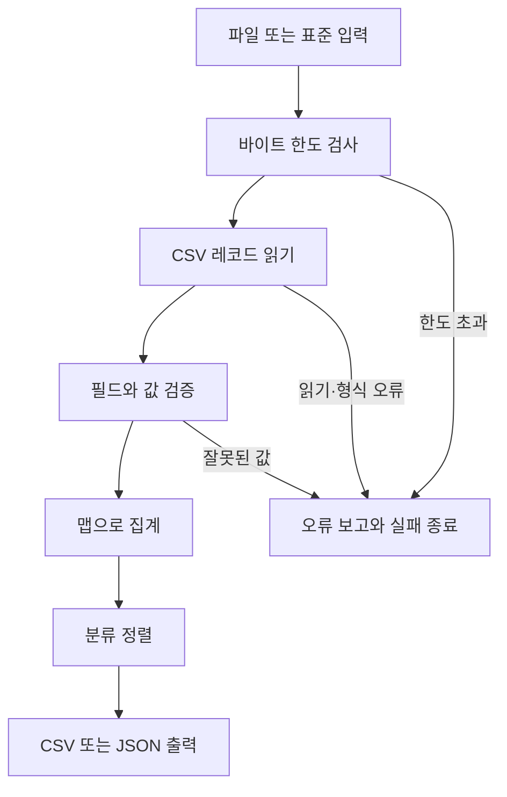

# 29. 종합 실습: CSV 분석 CLI

지금까지 배운 문자열, 맵, 오류, 파일, CLI와 테스트를 하나의 도구로 연결합니다.
프로그램은 분류별 금액이 적힌 CSV를 읽고 **건수와 금액 합계**를 출력합니다.
입력 파일이 잘못되면 어느 레코드·필드가 문제인지 알려 주고 실패로 종료합니다.

완성 프로그램을 먼저 실행한 뒤, 파싱·집계·출력·명령행의 책임을 나누어 읽습니다.
이 프로젝트는 가상의 작은 학습 자료를 사용합니다.
실제 고객·회사 데이터나 외부 계정은 필요하지 않습니다.

## 학습 목표

- CSV 입력의 형식·값·크기·레코드 수 계약을 코드로 구현한다.
- 레코드 파싱과 집계 로직을 재사용 가능한 패키지로 분리한다.
- 파일·표준 입력을 공통 Reader로 처리하고 CSV·JSON으로 출력한다.
- 오류에 레코드 위치와 원인을 남기고 종료 코드로 실패를 알린다.
- 정상·경계·입출력 실패·퍼징 검사를 통해 완성 도구의 계약을 확인한다.

## 사전 지식과 준비

[06장 맵](../06-maps/README.md), [07장 문자열](../07-strings-unicode/README.md),
[10장 패키지](../10-packages-modules/README.md), [11장 오류](../11-errors-defer/README.md),
[14장 파일](../14-files-io/README.md), [15장 CSV·JSON](../15-data-time/README.md),
[16장 CLI](../16-cli/README.md), [27장 퍼징](../27-fuzzing/README.md)을 조합합니다.

- 기준: 2026-11-09, Go 1.27.3, 루트 단일 모듈.
- 실행 위치: 별도 안내가 없으면 저장소 루트.
- 완성 명령: [`cmd/csvstats`](../../examples/29-csv-cli/cmd/csvstats/main.go).
- 핵심 패키지: [`report`](../../examples/29-csv-cli/report/model.go).
- 입력 자료: [`sales.csv`](../../examples/29-csv-cli/testdata/sales.csv).
- 이 프로젝트의 코드는 Go 표준 라이브러리만 사용합니다.

CSV 형식은 [encoding/csv](https://pkg.go.dev/encoding/csv),
명령행 옵션은 [flag](https://pkg.go.dev/flag),
입출력의 기본 계약은 [io](https://pkg.go.dev/io)를 기준으로 합니다.

## 1. 완성 프로그램부터 실행하기

제공하는 가상 입력은 다음과 같습니다.

```csv
category,amount
도서,12000
식품,5000
도서,8000
```

```sh
go run ./examples/29-csv-cli/cmd/csvstats -input examples/29-csv-cli/testdata/sales.csv
```

예상 출력:

```text
category,count,total
도서,2,20000
식품,1,5000
```

도서는 두 레코드의 금액을 합쳐 20000입니다.
식품은 한 레코드의 금액 5000입니다.
맵에 들어간 순서와 관계없이 분류 이름순으로 출력합니다.
이 정렬은 문자열의 비교 순서이며 언어별 사전 정렬을 구현한 것은 아닙니다.

### 1.1 JSON 출력

```sh
go run ./examples/29-csv-cli/cmd/csvstats -input examples/29-csv-cli/testdata/sales.csv -format json
```

```json
{
  "rows": 3,
  "total": 25000,
  "groups": [
    {
      "category": "도서",
      "count": 2,
      "total": 20000
    },
    {
      "category": "식품",
      "count": 1,
      "total": 5000
    }
  ]
}
```

CSV 형식은 그룹별 표를, JSON 형식은 전체 행 수·전체 합계·그룹 목록을 제공합니다.
출력 형식마다 담는 필드를 문서화했으므로 소비자가 다른 의미로 추정하지 않게 합니다.
정상 결과 외의 안내 문구를 표준 출력에 섞지 않습니다.

### 1.2 잘못된 입력

```sh
go run ./examples/29-csv-cli/cmd/csvstats -input examples/29-csv-cli/testdata/invalid.csv
```

프로그램의 표준 오류에는 다음 메시지가 나옵니다.

```text
analyze: record 3 field amount: invalid CSV input: expected decimal digits
```

`go run`은 실패한 하위 프로그램의 종료 상태를 추가로 표시할 수 있습니다.
이 경우 분석 결과는 표준 출력에 쓰지 않습니다.
실행 파일의 종료 코드는 뒤의 빌드 실습에서 직접 확인합니다.

## 2. 입력 계약을 먼저 고정하기

### 2.1 파일 형식

| 항목 | 계약 |
| --- | --- |
| 헤더 | 첫 CSV 레코드가 정확히 `category,amount` |
| 데이터 필드 수 | 정확히 두 개 |
| 구분자·인용 | 표준 csv.Reader의 쉼표·따옴표 규칙 |
| 빈 줄 | csv.Reader가 건너뜀 |
| 레코드 번호 | 헤더를 1로 센 논리적 CSV 레코드 번호 |
| 입력 없음 | 헤더가 없으므로 오류 |
| 헤더만 있음 | 데이터 0개인 정상 입력 |

CSV의 한 레코드가 물리적 여러 줄에 걸칠 수 있습니다.
따라서 레코드 번호를 파일의 줄 번호와 같은 값이라고 소개하지 않습니다.
CSV 문법 오류 자체에는 표준 라이브러리의 ParseError가 추가 위치 정보를 줄 수 있습니다.
[Reader.Read](https://pkg.go.dev/encoding/csv#Reader.Read)의 규칙을 참고하세요.

### 2.2 값의 범위

| 필드 | 계약 |
| --- | --- |
| category | 앞뒤 공백 제거 후 유효한 UTF-8 1~40룬 |
| category의 제어 문자 | 제거한 앞뒤 공백을 제외한 값 안에서는 허용하지 않음 |
| amount | 앞뒤 공백 제거 후 ASCII 숫자만, 0~1000000000 |
| amount의 단위 | 이 가상 자료의 정수 금액 단위 |
| 빈 값·음수·소수·부호 | 금액에서 거부 |

금액을 부동소수점으로 합하지 않습니다.
소수 단위가 필요한 실제 프로그램이라면 최소 단위의 정수로 바꾸는 형식을 별도로 정해야 합니다.
이 프로젝트의 정수 금액 정책은 학습 범위를 정하기 위한 설계 선택입니다.

### 2.3 자원 한도

기본 최대 바이트 수는 1MiB, 데이터 레코드는 10000개입니다.
명령행에서 바꿀 수 있지만 바이트는 최대 64MiB, 레코드는 최대 1000000개로 제한합니다.
최대 금액과 최대 레코드 수를 곱해도 합계가 int64 범위 안에 있도록 정했습니다.

한도는 무조건 큰 파일을 잘라 읽으라는 뜻이 아닙니다.
입력이 한도를 넘으면 전체 분석을 실패시킵니다.
한도까지 읽은 일부 결과를 정상 전체 결과처럼 내보내지 않습니다.

## 3. 책임을 나눈 구조

| 경로 | 책임 |
| --- | --- |
| `report/model.go` | 자료형, 옵션·행 입력 검증, 위치 있는 오류 |
| `report/analyze.go` | CSV 읽기, 한도 검사, 집계 |
| `report/write.go` | 정렬된 CSV·JSON 출력 |
| `report/report_test.go` | 데이터·입출력·불변 조건 검증 |
| `cmd/csvstats/main.go` | 플래그, 파일 열기·닫기, 표준 입출력, 종료 코드 |
| `cmd/csvstats/main_test.go` | 명령행 전체 계약 검사 |



이 흐름은 동기적으로 진행됩니다.
입력을 빨리 읽는다는 이유로 아직 배우지 않은 동시 파이프라인을 섞지 않습니다.
동시 처리의 종료와 취소는 마지막 31장에서 별도 프로젝트로 다룹니다.

### 3.1 `main`을 가져다 쓰지 않기

재사용할 계산은 일반 패키지 `report`에 두었습니다.
여러 단계 예제와 연습문제가 이 패키지를 가져와 같은 입력 계약을 사용합니다.
루트 모듈 경로 뒤에 예제 디렉터리 경로를 붙인 것이 import 경로입니다.
새 하위 `go.mod`를 만들 필요가 없습니다.

## 4. 한 행을 자료형으로 바꾸기

소스: [`report/model.go`](../../examples/29-csv-cli/report/model.go)

```go
package report

import (
	"errors"
	"fmt"
	"strconv"
	"strings"
	"unicode"
	"unicode/utf8"
)

var ErrInput = errors.New("invalid CSV input")
var ErrLimit = errors.New("input limit exceeded")

type DataError struct {
	Record int
	Field  string
	Err    error
}

func (e *DataError) Error() string {
	return fmt.Sprintf("record %d field %s: %v", e.Record, e.Field, e.Err)
}
func (e *DataError) Unwrap() error { return e.Err }

type Record struct {
	Category string
	Amount   int64
}
type Group struct {
	Category string `json:"category"`
	Count    int    `json:"count"`
	Total    int64  `json:"total"`
}
type Summary struct {
	Rows   int     `json:"rows"`
	Total  int64   `json:"total"`
	Groups []Group `json:"groups"`
}

type Options struct {
	MaxBytes int64
	MaxRows  int
}

func DefaultOptions() Options { return Options{MaxBytes: 1 << 20, MaxRows: 10000} }
func (o Options) Validate() error {
	if o.MaxBytes < 1 || o.MaxBytes > 64<<20 {
		return errors.New("max-bytes must be 1..67108864")
	}
	if o.MaxRows < 1 || o.MaxRows > 1000000 {
		return errors.New("max-rows must be 1..1000000")
	}
	return nil
}

func ParseRow(fields []string, recordNumber int) (Record, error) {
	fail := func(field, message string) (Record, error) {
		return Record{}, &DataError{recordNumber, field, fmt.Errorf("%w: %s", ErrInput, message)}
	}
	if len(fields) != 2 {
		return fail("row", "expected 2 fields")
	}
	category := strings.TrimSpace(fields[0])
	if category == "" || !utf8.ValidString(category) || utf8.RuneCountInString(category) > 40 {
		return fail("category", "expected 1..40 valid UTF-8 runes")
	}
	for _, ch := range category {
		if unicode.IsControl(ch) {
			return fail("category", "control character is not allowed")
		}
	}
	amountText := strings.TrimSpace(fields[1])
	if amountText == "" {
		return fail("amount", "expected decimal digits")
	}
	for _, ch := range amountText {
		if ch < '0' || ch > '9' {
			return fail("amount", "expected decimal digits")
		}
	}
	amount, err := strconv.ParseInt(amountText, 10, 64)
	if err != nil || amount > 1000000000 {
		return fail("amount", "expected 0..1000000000")
	}
	return Record{category, amount}, nil
}
```

### 4.1 서로 다른 자료형의 역할

`Record`는 검증을 마친 데이터 한 개입니다.
`Group`은 분류 하나의 건수와 합계입니다.
`Summary`는 전체 행 수·합계와 그룹 목록입니다.
입력용 자료와 집계 결과를 구분하면 계산의 책임이 명확해집니다.

오류의 문자열만 해석해 필드 위치를 찾지 않습니다.
`DataError`에 Record·Field·Err를 보관하고 `Unwrap`으로 원인을 연결합니다.
호출자는 `errors.As`로 위치 정보를, `errors.Is`로 입력 오류 분류를 확인할 수 있습니다.
[오류 래핑](https://pkg.go.dev/errors)을 이용한 구조입니다.

### 4.2 변환 전에 검사하는 순서

필드 개수가 두 개가 아니면 인덱스를 사용하기 전에 거부합니다.
분류는 공백·UTF-8·룬 길이·제어 문자를 확인합니다.
금액은 문자열의 허용 문자를 먼저 검사한 뒤 ParseInt로 변환합니다.
마지막으로 업무상 최대값을 확인합니다.

이 순서는 언어가 자동으로 제공하는 검증이 아닙니다.
우리가 선택한 입력 형식을 코드로 옮긴 것입니다.
예를 들어 `+1`은 정수 변환 함수가 받아들일 수 있어도 이번 CSV 형식에서는 거부합니다.

### 4.3 최소 실행 예

소스: [`parse-row/main.go`](../../examples/29-csv-cli/parse-row/main.go)

```go
package main

import (
	"fmt"

	"github.com/praster1/GoLang_all_in_one/examples/29-csv-cli/report"
)

func main() {
	row, err := report.ParseRow([]string{" 도서 ", "12000"}, 2)
	if err != nil {
		fmt.Println("error:", err)
		return
	}
	fmt.Printf("%s: %d\n", row.Category, row.Amount)
}
```

```sh
go run ./examples/29-csv-cli/parse-row
```

```text
도서: 12000
```

입력 앞뒤의 공백은 정리되지만 내부의 문자는 보존합니다.
CSV 구분자 자체를 이 함수가 해석하지는 않습니다.
`[]string`을 만드는 책임은 csv.Reader에 있습니다.

## 5. 위치 있는 오류 읽기

소스: [`diagnostics/main.go`](../../examples/29-csv-cli/diagnostics/main.go)

```go
package main

import (
	"errors"
	"fmt"

	"github.com/praster1/GoLang_all_in_one/examples/29-csv-cli/report"
)

func main() {
	_, err := report.ParseRow([]string{"도서", "bad"}, 3)
	var detail *report.DataError
	if errors.As(err, &detail) {
		fmt.Println("레코드:", detail.Record)
		fmt.Println("필드:", detail.Field)
	}
	fmt.Println("입력 오류:", errors.Is(err, report.ErrInput))
}
```

```sh
go run ./examples/29-csv-cli/diagnostics
```

```text
레코드: 3
필드: amount
입력 오류: true
```

`DataError`의 필드는 사람이 읽는 문구를 바꾸어도 구조적으로 사용할 수 있습니다.
반면 운영체제의 파일 오류 문구를 그대로 파싱하면 OS나 언어 환경에 따라 깨질 수 있습니다.
테스트도 중요한 종류·위치·실패 여부를 확인하고 불필요하게 전체 시스템 메시지에 묶이지 않습니다.

전체 CSV 문법 오류는 반드시 DataError인 것은 아닙니다.
csv.Reader가 발견한 따옴표 문법 오류나 파일 읽기 오류는 다른 원인을 감싸 돌려줍니다.
서로 다른 오류의 출처를 하나로 단정하지 않습니다.

## 6. 읽으면서 집계하기

소스: [`report/analyze.go`](../../examples/29-csv-cli/report/analyze.go)

```go
package report

import (
	"encoding/csv"
	"fmt"
	"io"
	"slices"
	"strings"
)

func Analyze(input io.Reader, options Options) (Summary, error) {
	if err := options.Validate(); err != nil {
		return Summary{}, err
	}
	limited := &io.LimitedReader{R: input, N: options.MaxBytes + 1}
	reader := csv.NewReader(limited)
	reader.FieldsPerRecord = -1
	header, err := reader.Read()
	if limited.N == 0 {
		return Summary{}, fmt.Errorf("%w: max-bytes=%d", ErrLimit, options.MaxBytes)
	}
	if err != nil {
		if err == io.EOF {
			return Summary{}, fmt.Errorf("%w: missing header", ErrInput)
		}
		return Summary{}, fmt.Errorf("read header: %w", err)
	}
	if !slices.Equal(header, []string{"category", "amount"}) {
		return Summary{}, fmt.Errorf("%w: header must be category,amount", ErrInput)
	}
	groups := make(map[string]Group)
	summary := Summary{Groups: make([]Group, 0)}
	for recordNumber := 2; ; recordNumber++ {
		fields, err := reader.Read()
		if limited.N == 0 {
			return Summary{}, fmt.Errorf("%w: max-bytes=%d", ErrLimit, options.MaxBytes)
		}
		if err == io.EOF {
			break
		}
		if err != nil {
			return Summary{}, fmt.Errorf("read record %d: %w", recordNumber, err)
		}
		if summary.Rows == options.MaxRows {
			return Summary{}, fmt.Errorf("%w: max-rows=%d", ErrLimit, options.MaxRows)
		}
		record, err := ParseRow(fields, recordNumber)
		if err != nil {
			return Summary{}, err
		}
		group := groups[record.Category]
		group.Category = record.Category
		group.Count++
		group.Total += record.Amount
		groups[record.Category] = group
		summary.Rows++
		summary.Total += record.Amount
	}
	for _, group := range groups {
		summary.Groups = append(summary.Groups, group)
	}
	slices.SortFunc(summary.Groups, func(a, b Group) int { return strings.Compare(a.Category, b.Category) })
	return summary, nil
}
```

### 6.1 헤더를 데이터와 구분

첫 레코드가 없으면 입력 오류입니다.
헤더가 있으면 필드 이름·순서를 정확히 비교합니다.
열을 자동으로 추측하지 않으므로 잘못된 파일을 우연히 계산하는 일을 줄입니다.
열 순서를 유연하게 받으려면 이름별 인덱스를 만드는 별도 설계와 테스트가 필요합니다.

`FieldsPerRecord=-1`은 표준 Reader의 자동 필드 수 일치 검사를 끕니다.
우리 ParseRow가 각 레코드의 필드 수를 검사하여 일관된 위치 오류를 만들기 위한 선택입니다.
필드 수 검사를 없앤 것이 아니라 책임을 옮긴 것입니다.

### 6.2 한도보다 한 바이트 더 읽기

`io.LimitedReader`에 최대값+1을 지정합니다.
정확히 한도인 입력과 한도를 넘는 입력을 구분하려는 것입니다.
남은 N이 0이면 한도를 초과한 바이트까지 읽은 것이므로 실패합니다.
[LimitedReader](https://pkg.go.dev/io#LimitedReader)의 읽기 상한을 사용합니다.

옵션에서 최대 바이트를 먼저 제한하므로 `MaxBytes+1` 계산이 범위를 넘지 않습니다.
csv.Reader는 내부 버퍼를 사용할 수 있으므로 초과를 발견한 시점이
독자가 생각한 특정 레코드 경계와 항상 같지는 않습니다.
바이트 한도는 입력 전체의 계약으로 설명합니다.

CSV 파서는 빈 줄을 건너뛰지만, 그 바이트도 입력 한도에는 포함합니다.
따라서 EOF를 확인한 직후에도 제한 초과 여부를 먼저 판정해야 합니다.
`TestAnalyzeByteLimitAtEOF`는 헤더만 있는 입력과 마지막에 빈 줄이 있는 입력에서, 정확한 바이트 수는 성공하고 한 바이트 작은 한도는 실패하는지 확인합니다.

### 6.3 행 수와 금액 합계

정상 데이터 레코드 하나를 처리하면 전체 Rows와 해당 Group.Count를 1 늘립니다.
금액도 전체 합계와 그룹 합계에 더합니다.
다음 세 관계를 유지합니다.

- 전체 Rows는 그룹 Count의 합입니다.
- 전체 Total은 그룹 Total의 합입니다.
- 모든 Group.Count는 양수입니다.

그룹별 누적을 마친 뒤 맵 값을 슬라이스로 옮겨 정렬합니다.
맵 순회 순서를 출력 계약으로 사용하지 않습니다.

### 6.4 최소 집계 실행

소스: [`aggregate/main.go`](../../examples/29-csv-cli/aggregate/main.go)

```go
package main

import (
	"fmt"
	"strings"

	"github.com/praster1/GoLang_all_in_one/examples/29-csv-cli/report"
)

func main() {
	input := "category,amount\n도서,12\n식품,5\n도서,8\n"
	summary, err := report.Analyze(strings.NewReader(input), report.DefaultOptions())
	if err != nil {
		fmt.Println("error:", err)
		return
	}
	fmt.Printf("행: %d, 합계: %d, 분류: %d\n", summary.Rows, summary.Total, len(summary.Groups))
}
```

```sh
go run ./examples/29-csv-cli/aggregate
```

```text
행: 3, 합계: 25, 분류: 2
```

## 7. 경계에서 전체 실패하기

소스: [`limits/main.go`](../../examples/29-csv-cli/limits/main.go)

```go
package main

import (
	"errors"
	"fmt"
	"strings"

	"github.com/praster1/GoLang_all_in_one/examples/29-csv-cli/report"
)

func main() {
	input := "category,amount\nx,1\n"
	options := report.Options{MaxBytes: int64(len(input)), MaxRows: 1}
	_, err := report.Analyze(strings.NewReader(input), options)
	fmt.Println("경계 허용:", err == nil)
	options.MaxBytes--
	_, err = report.Analyze(strings.NewReader(input), options)
	fmt.Println("초과 거부:", errors.Is(err, report.ErrLimit))
}
```

```sh
go run ./examples/29-csv-cli/limits
```

```text
경계 허용: true
초과 거부: true
```

처음에는 입력의 실제 바이트 길이를 한도로 설정합니다.
다음에는 한도를 한 바이트 줄여 같은 입력이 초과하도록 만듭니다.
한글은 여러 바이트이므로 `len(input)`과 룬 개수를 바꾸어 사용하지 않습니다.

### 7.1 부분 결과를 돌려주지 않는 정책

분석 중 오류가 나면 `Summary{}`와 오류를 반환합니다.
앞에서 읽은 정상 행의 합계를 성공 결과처럼 출력하지 않습니다.
첫 오류에서 중단하는 정책이므로 여러 오류를 한꺼번에 모아 보고하지는 않습니다.

부분 결과가 필요한 도구라면 처리한 행 수, 제외된 행 수, 오류 목록,
출력의 신뢰 수준과 종료 코드를 별도로 정의해야 합니다.
이 프로젝트에서는 모든 입력이 유효할 때만 보고서를 만드는 정책을 선택했습니다.

## 8. CSV·JSON 출력과 입력 보존

소스: [`report/write.go`](../../examples/29-csv-cli/report/write.go)

```go
package report

import (
	"encoding/csv"
	"encoding/json"
	"io"
	"slices"
	"strconv"
	"strings"
)

func ordered(summary Summary) Summary {
	summary.Groups = append([]Group{}, summary.Groups...)
	slices.SortFunc(summary.Groups, func(a, b Group) int { return strings.Compare(a.Category, b.Category) })
	return summary
}

func WriteCSV(output io.Writer, summary Summary) error {
	writer := csv.NewWriter(output)
	if err := writer.Write([]string{"category", "count", "total"}); err != nil {
		return err
	}
	for _, group := range ordered(summary).Groups {
		if err := writer.Write([]string{group.Category, strconv.Itoa(group.Count), strconv.FormatInt(group.Total, 10)}); err != nil {
			return err
		}
	}
	writer.Flush()
	return writer.Error()
}

func WriteJSON(output io.Writer, summary Summary) error {
	encoder := json.NewEncoder(output)
	encoder.SetIndent("", "  ")
	return encoder.Encode(ordered(summary))
}
```

### 8.1 출력 함수가 원본을 정렬하지 않게 하기

`Summary`를 값으로 받더라도 그 안의 슬라이스는 저장 공간을 공유할 수 있습니다.
그래서 그룹 슬라이스를 복사한 뒤 정렬합니다.
출력 함수를 호출한 것만으로 호출자가 가진 그룹 순서가 바뀌지 않습니다.
05장과 08장에서 배운 값 복사·저장 공간 공유를 적용한 부분입니다.

소스: [`sort-results/main.go`](../../examples/29-csv-cli/sort-results/main.go)

```go
package main

import (
	"fmt"
	"os"

	"github.com/praster1/GoLang_all_in_one/examples/29-csv-cli/report"
)

func main() {
	summary := report.Summary{Rows: 2, Total: 3, Groups: []report.Group{{Category: "z", Count: 1, Total: 1}, {Category: "a", Count: 1, Total: 2}}}
	if err := report.WriteCSV(os.Stdout, summary); err != nil {
		fmt.Println("error:", err)
		return
	}
	fmt.Println("원본 첫 분류:", summary.Groups[0].Category)
}
```

```sh
go run ./examples/29-csv-cli/sort-results
```

```text
category,count,total
a,1,2
z,1,1
원본 첫 분류: z
```

실제 CLI는 마지막 설명 문구를 출력하지 않습니다.
이 단계 예제에서 원본 순서가 보존됨을 보여 주기 위해 추가한 출력입니다.

### 8.2 CSV 쓰기 오류

Writer.Write가 성공했더라도 버퍼의 최종 쓰기가 실패할 수 있습니다.
따라서 Flush 뒤 Error를 확인합니다.
실패를 무시하면 출력 파일이 불완전한데도 성공으로 종료할 수 있습니다.
[CSV Writer.Error](https://pkg.go.dev/encoding/csv#Writer.Error)의 역할을 확인하세요.

### 8.3 빈 목록의 JSON 표현

소스: [`json-output/main.go`](../../examples/29-csv-cli/json-output/main.go)

```go
package main

import (
	"fmt"
	"os"

	"github.com/praster1/GoLang_all_in_one/examples/29-csv-cli/report"
)

func main() {
	if err := report.WriteJSON(os.Stdout, report.Summary{}); err != nil {
		fmt.Println("error:", err)
	}
}
```

```sh
go run ./examples/29-csv-cli/json-output
```

```json
{
  "rows": 0,
  "total": 0,
  "groups": []
}
```

그룹이 없어도 목록은 `[]`로 표현합니다.
JSON v1에서 nil 슬라이스와 빈 슬라이스의 기본 인코딩이 다르므로 출력 전에 형태를 맞춥니다.
[JSON 인코딩 규칙](https://pkg.go.dev/encoding/json#Marshal)을 참고하세요.

출력 함수는 임의로 전달된 Summary의 Rows·Total을 다시 계산하지 않습니다.
그 일관성을 만드는 책임은 Analyze와 확장 함수에 있습니다.
입력 자료의 검증과 보고서 형식의 책임을 구분합니다.

## 9. CLI와 파일 수명 연결하기

소스: [`cmd/csvstats/main.go`](../../examples/29-csv-cli/cmd/csvstats/main.go)

```go
package main

import (
	"errors"
	"flag"
	"fmt"
	"io"
	"os"

	"github.com/praster1/GoLang_all_in_one/examples/29-csv-cli/report"
)

func run(args []string, input io.Reader, output, errOutput io.Writer) (code int) {
	defaults := report.DefaultOptions()
	fs := flag.NewFlagSet("csvstats", flag.ContinueOnError)
	fs.SetOutput(errOutput)
	path := fs.String("input", "-", "CSV path or - for standard input")
	format := fs.String("format", "csv", "csv or json")
	maxBytes := fs.Int64("max-bytes", defaults.MaxBytes, "maximum input bytes")
	maxRows := fs.Int("max-rows", defaults.MaxRows, "maximum data records")
	if err := fs.Parse(args); err != nil {
		if errors.Is(err, flag.ErrHelp) {
			return 0
		}
		return 2
	}
	options := report.Options{MaxBytes: *maxBytes, MaxRows: *maxRows}
	if fs.NArg() != 0 || (*format != "csv" && *format != "json") || *path == "" {
		fmt.Fprintln(errOutput, "invalid arguments: use -input, -format csv|json, and no positional arguments")
		return 2
	}
	if err := options.Validate(); err != nil {
		fmt.Fprintln(errOutput, err)
		return 2
	}
	if *path != "-" {
		file, err := os.Open(*path)
		if err != nil {
			fmt.Fprintln(errOutput, "open:", err)
			return 1
		}
		defer func() {
			if err := file.Close(); err != nil && code == 0 {
				fmt.Fprintln(errOutput, "close:", err)
				code = 1
			}
		}()
		input = file
	}
	summary, err := report.Analyze(input, options)
	if err != nil {
		fmt.Fprintln(errOutput, "analyze:", err)
		return 1
	}
	if *format == "json" {
		err = report.WriteJSON(output, summary)
	} else {
		err = report.WriteCSV(output, summary)
	}
	if err != nil {
		fmt.Fprintln(errOutput, "write:", err)
		return 1
	}
	return 0
}

func main() {
	if code := run(os.Args[1:], os.Stdin, os.Stdout, os.Stderr); code != 0 {
		os.Exit(code)
	}
}
```

### 9.1 플래그와 종료 코드

| 옵션 | 기본값 | 의미 |
| --- | --- | --- |
| `-input` | `-` | 표준 입력 또는 파일 경로 |
| `-format` | `csv` | csv 또는 json |
| `-max-bytes` | 1048576 | 전체 입력 바이트 한도 |
| `-max-rows` | 10000 | 데이터 레코드 수 한도 |
| `-h` | 없음 | 도움말 표시 |

| 종료 코드 | 의미 |
| ---: | --- |
| 0 | 정상 처리 또는 도움말 |
| 1 | 파일·분석·출력 등 실행 중 실패 |
| 2 | 플래그·형식·한도 설정 오류 |

옵션 검증을 파일 열기보다 먼저 수행합니다.
형식이 잘못된 명령 때문에 불필요한 입력 파일을 읽지 않습니다.
파일 경로가 `-`이면 전달받은 표준 입력 Reader를 사용합니다.
그 외에는 파일을 열고 현재 호출이 끝날 때 닫습니다.

### 9.2 입력 소유권

호출자가 전달한 표준 입력은 `run`이 닫지 않습니다.
직접 연 파일만 직접 닫습니다.
파일 닫기에서 오류가 나고 다른 오류가 없었다면 실행 실패로 처리합니다.
이미 분석 실패가 있었다면 먼저 발생한 원인을 유지합니다.

이 구조 덕분에 테스트는 실제 프로세스의 stdin을 바꾸지 않고
`strings.NewReader`를 전달할 수 있습니다.
파일 경로와 표준 입력 경로의 차이는 CLI에 있고 집계 함수는 공통입니다.

### 9.3 언제 출력하는가

분석이 전부 끝난 뒤에만 출력 함수를 호출합니다.
따라서 입력 오류 때문에 실패한 경우 표준 출력은 비어 있습니다.
다만 출력 도중 Writer가 실패하면 이미 전달한 일부 바이트를 되돌릴 수는 없습니다.
이때도 종료 코드 1을 반환하여 소비자가 실패를 알 수 있게 합니다.

결과 파일을 완성된 상태로만 교체해야 한다면
임시 파일에 쓰고 닫은 뒤 교체하는 별도 저장 정책이 필요합니다.
이번 기본 CLI는 임의의 Writer를 사용하는 스트림 출력입니다.

## 10. 표준 입력과 결과 파일

### 10.1 Bash 파이프

```sh
cat examples/29-csv-cli/testdata/sales.csv | go run ./examples/29-csv-cli/cmd/csvstats -input -
```

표준 입력을 기본값으로 쓰므로 `-input -`를 생략해도 됩니다.
직접 터미널에서 입력을 기다리는 상태라면 사용 중인 셸의 EOF 입력 방식으로 마칩니다.
파일을 다루는 기본 학습은 앞의 `-input 파일경로` 방식으로 진행해도 됩니다.

### 10.2 PowerShell의 인코딩 주의

파일을 읽는 기본 명령은 PowerShell에서도 같습니다.

```powershell
go run ./examples/29-csv-cli/cmd/csvstats -input examples/29-csv-cli/testdata/sales.csv
```

PowerShell 버전과 네이티브 파이프 인코딩 설정에 따라 문자열을 파이프로 전달하는 바이트가 달라질 수 있습니다.
특히 Windows PowerShell 5.1의 텍스트 인코딩 기본값을 PowerShell 7과 같다고 가정하지 않습니다.
한글 입력을 처음 확인할 때는 프로그램이 파일을 직접 여는 경로를 사용합니다.

### 10.3 출력 리다이렉션의 범위

Bash 예:

```sh
mkdir -p _practice/29-csv-cli
go run ./examples/29-csv-cli/cmd/csvstats -input examples/29-csv-cli/testdata/sales.csv -format json > _practice/29-csv-cli/report.json
```

위 명령은 해당 실습의 기존 report.json을 교체합니다.
셸은 프로그램이 성공하기 전에 출력 파일을 만들거나 비울 수 있습니다.
프로그램이 입력 오류로 표준 출력을 쓰지 않더라도 기존 결과를 보존하는 저장 방식은 아닙니다.
성공한 결과만 교체하려면 별도의 임시 경로와 성공 확인 절차가 필요합니다.

Windows에서 리다이렉션한 텍스트를 다른 도구로 읽을 때도 인코딩을 확인합니다.
Go가 생성한 JSON 바이트와 셸이 텍스트로 다시 저장한 결과를 구분하세요.

## 11. 테스트로 기능을 묶기

전체 테스트 소스는 [`report_test.go`](../../examples/29-csv-cli/report/report_test.go)와
[`main_test.go`](../../examples/29-csv-cli/cmd/csvstats/main_test.go)에 있습니다.

```sh
go test -count=1 ./examples/29-csv-cli/...
```

### 11.1 중요한 검사 목록

| 경계 | 검사 |
| --- | --- |
| 필드 개수 | 1개·3개 레코드 거부 |
| 분류 | 공백, 41룬, 잘못된 UTF-8, 내부 제어 문자 |
| 금액 | 0, 최대값, 음수·부호·소수·큰 값 |
| CSV | 인용된 쉼표, CRLF, 잘못된 따옴표 |
| 입력 크기 | 정확한 최대값 성공, 한 바이트 초과 실패 |
| 레코드 수 | 정확한 최대값 성공, 한 레코드 초과 실패 |
| 빈 자료 | 입력 없음 실패, 헤더만 있음 성공 |
| 오류 | 입력·출력 장치 오류의 원인 보존 |
| 정렬 | 결과 순서 고정, 호출자 그룹 순서 보존 |
| CLI | stdin·파일·JSON·잘못된 옵션·출력 실패 |

### 11.2 명령행 계약 테스트 전체

```go
package main

import (
	"bytes"
	"encoding/json"
	"errors"
	"io"
	"os"
	"path/filepath"
	"strings"
	"testing"
)

const data = "category,amount\n도서,12\n식품,5\n도서,8\n"

func TestRun(t *testing.T) {
	for _, tc := range []struct {
		name  string
		args  []string
		input string
		code  int
		want  string
	}{
		{"stdin", nil, data, 0, "category,count,total\n도서,2,20\n식품,1,5\n"},
		{"empty-data", nil, "category,amount\n", 0, "category,count,total\n"},
		{"invalid", nil, "category,amount\nx,1\ny,bad\n", 1, ""},
		{"format", []string{"-format", "xml"}, data, 2, ""},
		{"rows", []string{"-max-rows", "0"}, data, 2, ""},
		{"limit", []string{"-max-rows", "1"}, data, 1, ""},
		{"argument", []string{"unexpected"}, data, 2, ""},
		{"help", []string{"-h"}, "", 0, ""},
	} {
		t.Run(tc.name, func(t *testing.T) {
			var out, errOut bytes.Buffer
			code := run(tc.args, strings.NewReader(tc.input), &out, &errOut)
			if code != tc.code || out.String() != tc.want {
				t.Fatalf("code=%d out=%q err=%q", code, out.String(), errOut.String())
			}
			if tc.code != 0 && errOut.Len() == 0 {
				t.Fatal("missing error report")
			}
		})
	}
}

func TestFileAndJSON(t *testing.T) {
	path := filepath.Join(t.TempDir(), "sales.csv")
	if err := os.WriteFile(path, []byte(data), 0600); err != nil {
		t.Fatal(err)
	}
	var out, errOut bytes.Buffer
	if code := run([]string{"-input", path, "-format", "json"}, strings.NewReader("ignored"), &out, &errOut); code != 0 {
		t.Fatal(errOut.String())
	}
	var result struct {
		Rows   int
		Total  int64
		Groups []struct{ Category string }
	}
	if err := json.Unmarshal(out.Bytes(), &result); err != nil || result.Rows != 3 || result.Total != 25 || len(result.Groups) != 2 {
		t.Fatal("JSON result")
	}
	if err := os.Remove(path); err != nil {
		t.Fatalf("file not closed: %v", err)
	}
	out.Reset()
	errOut.Reset()
	if code := run([]string{"-input", path}, strings.NewReader(data), &out, &errOut); code != 1 || out.Len() != 0 {
		t.Fatal("missing file")
	}
}

type failedWriter struct{}

func (failedWriter) Write(p []byte) (int, error) { return 0, errors.New("output unavailable") }

func TestOutputFailure(t *testing.T) {
	if code := run(nil, strings.NewReader(data), failedWriter{}, io.Discard); code != 1 {
		t.Fatal("output error ignored")
	}
}
```

첫 테스트는 입력과 출력·종료 코드를 표로 비교합니다.
분석 중 실패했을 때 표준 출력이 비어 있는지도 함께 확인합니다.
파일 테스트는 임시 파일을 만들어 분석한 뒤 지울 수 있는지 확인하여
Windows에서도 파일 핸들이 닫혔는지 검증합니다.

출력 실패는 실제 디스크를 가득 채우는 대신 실패하는 Writer를 주입합니다.
환경에 따라 가끔만 실패하는 검사를 피하면서 중요한 오류 경로를 재현합니다.
[테스트 임시 디렉터리](https://pkg.go.dev/testing#T.TempDir)와 인터페이스 주입을 조합한 예입니다.

### 11.3 퍼징으로 집계 관계 확인

`report_test.go`의 `FuzzAnalyze`는 임의의 바이트 입력을 분석합니다.
잘못된 입력에 오류가 나면 정상 거부로 보고,
성공한 경우 다음 관계를 확인합니다.

- 그룹 건수의 합이 전체 Rows와 같습니다.
- 그룹 금액의 합이 전체 Total과 같습니다.
- 그룹 이름은 정렬되어 있고 중복이 없습니다.
- 그룹 건수는 양수이고 합계는 음수가 아닙니다.
- 정해진 최대 레코드·금액 범위를 넘지 않습니다.

```sh
go test -run '^$' -fuzz '^FuzzAnalyze$' -fuzztime=5s -parallel=2 ./examples/29-csv-cli/report
```

이 타깃만으로 정상 입력을 모두 거부하는 결함을 찾을 수는 없습니다.
알려진 정상·경계 입력의 단위 테스트를 함께 유지하는 이유입니다.
본문의 최종 예제는 일반 검사와 제한 시간 퍼징을 각각 실행해 확인했습니다.

## 12. 실제 실행 파일로 확인하기

PowerShell:

```powershell
New-Item -ItemType Directory -Force _practice/29-csv-cli | Out-Null
go build -o ./_practice/29-csv-cli/csvstats.exe ./examples/29-csv-cli/cmd/csvstats
./_practice/29-csv-cli/csvstats.exe -input examples/29-csv-cli/testdata/sales.csv
./_practice/29-csv-cli/csvstats.exe -input examples/29-csv-cli/testdata/invalid.csv
$LASTEXITCODE
```

Bash:

```sh
mkdir -p _practice/29-csv-cli
go build -o ./_practice/29-csv-cli/csvstats ./examples/29-csv-cli/cmd/csvstats
./_practice/29-csv-cli/csvstats -input examples/29-csv-cli/testdata/sales.csv
./_practice/29-csv-cli/csvstats -input examples/29-csv-cli/testdata/invalid.csv
printf '%s\n' "$?"
```

잘못된 금액 입력에서 실행 파일의 종료 코드는 1입니다.
`-format xml`처럼 잘못된 옵션을 주면 2입니다.
정상 자료에서는 0입니다.
호출하는 셸이나 다른 프로그램은 이 값으로 성공 여부를 판단할 수 있습니다.

### 12.1 세 가지 완료 범위

1. 패키지 테스트: 계산과 오류 계약 확인.
2. 명령행 테스트: 옵션·입출력·파일 수명 확인.
3. 실제 바이너리: 빌드한 파일의 정상·오류 종료 확인.

이 세 검사는 같은 일을 반복하는 것이 아니라 서로 다른 경계를 확인합니다.
빌드 산출물 관리와 자동화는 [28장](../28-build-deploy/README.md)의 방법으로 이어갈 수 있습니다.

## 13. 직접 확장하기

완성 코드를 모두 한 번에 복사하기보다 작은 책임을 하나씩 확장합니다.
개인 폴더는 `_practice/29-csv-cli/` 아래에 만들고 기존 파일을 보존하세요.

### 13.1 분류 하나만 보여 주기

전체 입력을 분석한 뒤 그룹 이름이 일치하는 결과만 선택합니다.
잘못된 행이 선택하지 않은 분류에 속해도 입력 전체 검증 정책은 유지합니다.
필터링한 Rows와 Total은 선택한 그룹에서 다시 계산해야 합니다.

### 13.2 합계가 큰 분류부터 보여 주기

기본 정렬은 이름순입니다.
합계 내림차순으로 바꾸면 동률일 때의 두 번째 정렬 기준을 정해야 합니다.
이 프로젝트의 확장 문제에서는 이름 오름차순을 사용합니다.
맵 순회에 따라 같은 합계의 순서가 달라지지 않도록 합니다.

### 13.3 검증 요약을 추가하기

분석한 레코드 수와 결과 그룹 수는 서로 다릅니다.
“도서”가 여러 번 나와도 그룹은 하나입니다.
추가 통계를 넣을 때 이 두 단위를 구분하고 빈 입력의 의미를 정의합니다.
평균을 추가한다면 정수 나눗셈과 소수 표현 정책도 함께 정해야 합니다.

### 13.4 실행 중 실패 정책을 바꾸기 전에

잘못된 행을 건너뛰는 기능은 한 줄의 continue로 끝나지 않습니다.
제외 건수·오류 보고·부분 합계의 의미·종료 코드·허용 오류 수를 정해야 합니다.
기본 계약과 다른 기능으로 명시하고 테스트해야 합니다.
이번 장의 기본 프로그램은 첫 오류에서 전체 실패하는 정책을 유지합니다.

## 14. 자주 하는 실수

| 증상 | 원인 후보 | 확인·수정 |
| --- | --- | --- |
| 쉼표 포함 분류가 여러 열로 나뉨 | 문자열 Split으로 CSV 처리 | csv.Reader 사용 |
| 헤더가 데이터로 계산됨 | 첫 레코드 분리 누락 | 정확한 헤더 검사 |
| 잘못된 금액이 0으로 집계됨 | 변환 오류 무시 | 오류와 유효한 0 구분 |
| 출력 순서가 달라짐 | 맵을 바로 순회 | 키·그룹을 정렬 |
| 한글 길이 제한이 다름 | 바이트·룬 혼동 | 필드별 제한 단위 명시 |
| 최대값에서 정상 자료 거부 | 한도 비교의 경계 오류 | 정확히 최대와 초과를 테스트 |
| 일부 결과가 정상처럼 출력됨 | 읽는 중 즉시 보고서 출력 | 분석 완료 뒤 출력 |
| CSV 파일이 비었는데 성공 | Flush 오류 누락 | Flush 뒤 Error 확인 |
| 출력 뒤 원본 순서가 바뀜 | 슬라이스 공유 상태에서 정렬 | 복사한 그룹을 정렬 |
| Windows에서 파일 삭제 실패 | 열린 파일 누수 | 연 파일의 Close 책임 확인 |
| 오류 메시지가 stdout에 섞임 | 진단과 데이터 출력 혼합 | stderr와 stdout 분리 |
| 레코드 번호와 줄 번호가 다름 | CSV 다중 줄·빈 줄 특성 | 논리 레코드와 물리 줄을 구분 |

### 14.1 성능을 개선할 때 유지할 것

입력 한도·오류 위치·합계 범위·정렬·출력 계약을 유지합니다.
먼저 대표 자료와 입력 크기로 측정한 뒤 비용이 큰 부분을 찾아 바꿉니다.
근거 없이 문자열 검증을 없애거나 출력 순서를 불안정하게 바꾸지 않습니다.

그룹 수가 커질수록 맵과 결과 슬라이스도 커집니다.
전체 CSV를 메모리에 보관하지 않는다고 메모리 사용량이 항상 일정한 것은 아닙니다.
이 도구는 입력 크기와 레코드 수를 제한하여 처리 범위를 정합니다.

## 15. 연습문제와 참고 구현

[연습문제](../../exercises/29-csv-cli/README.md)는
결과 예측, 오류와 한도, 그룹 필터, 순위, 여러 입력 병합, 출력 바이트 완성을 다룹니다.
[해설](../../solutions/29-csv-cli/README.md)은
공유 report 패키지를 이용한 네 가지 확장 구현과 테스트를 제공합니다.

```sh
go test -count=1 ./examples/29-csv-cli/... ./solutions/29-csv-cli/...
```

단일 모듈 안에서 같은 계약을 재사용하지만,
참고 구현의 수정이 기본 CLI의 동작을 자동으로 바꾸지는 않습니다.
확장 기능을 실제 명령에 통합하려면 옵션과 호출 경로도 연결해야 합니다.

## 16. 요약과 자기 점검

CSV 형식 해석은 표준 Reader에 맡기고,
그 뒤 필드·값·한도라는 프로젝트 계약을 검사했습니다.
검증된 레코드를 맵으로 집계하고 정렬한 결과를 CSV·JSON으로 출력했습니다.
CLI는 파일 수명과 종료 코드를 담당하고 테스트 가능한 경계로 분리했습니다.

### 확인 질문

1. 헤더만 있는 입력과 완전히 빈 입력의 결과는 왜 다른가요?
2. ParseRow 전에 필드 수를 검사하는 이유는 무엇인가요?
3. MaxBytes보다 한 바이트 더 읽는 이유는 무엇인가요?
4. 레코드 번호를 물리 줄 번호라고 말할 수 없는 이유는 무엇인가요?
5. 전체 입력을 검사한 뒤에만 출력하면 어떤 계약을 지킬 수 있나요?
6. 출력 도중 쓰기 오류가 나면 이미 쓴 바이트를 되돌릴 수 있나요?
7. Summary를 값으로 받아도 정렬 전에 슬라이스를 복사하는 이유는 무엇인가요?
8. 합계가 int64 범위를 넘지 않는 근거는 무엇인가요?
9. 필터한 보고서의 Rows와 Total을 그대로 두면 어떤 문제가 생기나요?
10. 정상 입력을 모두 거부하는 구현을 퍼징만으로 놓칠 수 있는 이유는 무엇인가요?

<details>
<summary>답 확인</summary>

1. 헤더는 필수이며 헤더 뒤 데이터 0개는 허용한 입력이기 때문입니다.
2. 필드가 부족한 레코드에서 인덱스로 접근하는 오류를 피하고 명확한 위치 정보를 주기 위해서입니다.
3. 정확히 한도인 입력과 추가 바이트가 있는 입력을 구분하기 위해서입니다.
4. CSV 인용 필드 안의 줄바꿈과 빈 줄 처리 때문에 두 단위가 달라질 수 있습니다.
5. 입력 오류가 있는 자료의 부분 결과를 정상 전체 보고서로 출력하지 않을 수 있습니다.
6. 일반 Writer에 이미 쓴 바이트는 되돌릴 수 없으므로 실패 종료와 별도 저장 정책이 필요합니다.
7. 값 복사만으로 내부 슬라이스의 저장 공간까지 복제되지는 않기 때문입니다.
8. 레코드 최대 1000000개와 각 금액 최대 1000000000의 곱이 int64 범위 안입니다.
9. 그룹 합계·건수와 전체 요약이 모순되어 소비자가 결과를 잘못 해석할 수 있습니다.
10. 오류를 정상 거부로 처리하는 타깃에는 반드시 성공해야 하는 입력의 별도 검사가 필요하기 때문입니다.

</details>

### 완료 체크리스트

- [ ] 제공된 정상 CSV·JSON 결과를 실행했습니다.
- [ ] 빈 입력·헤더만 있는 입력을 구분했습니다.
- [ ] 필드·금액·크기·행 수 경계의 실패를 확인했습니다.
- [ ] 데이터와 진단 출력을 분리했습니다.
- [ ] 파일을 닫고 출력 오류를 확인했습니다.
- [ ] 결과 정렬과 원본 보존 테스트를 실행했습니다.
- [ ] 실행 파일의 0·1·2 종료 코드를 확인했습니다.
- [ ] 일반 테스트와 제한 시간 퍼징을 구분해 실행했습니다.

## 참고 자료

- [encoding/csv](https://pkg.go.dev/encoding/csv)
- [encoding/json](https://pkg.go.dev/encoding/json)
- [io.LimitedReader](https://pkg.go.dev/io#LimitedReader)
- [flag](https://pkg.go.dev/flag)
- [errors](https://pkg.go.dev/errors)
- [strconv.ParseInt](https://pkg.go.dev/strconv#ParseInt)
- [testing](https://pkg.go.dev/testing)
- [Go Fuzzing](https://go.dev/doc/security/fuzz/)

확인 기준: 2026-11-09, Go 1.27.3.
가상의 자료로 기본 프로그램·경계·입출력 오류·제한 시간 퍼징을 검증합니다.

## 다음 학습

[30장 할 일 HTTP API](../30-todo-api/README.md)에서는
명령행의 입력·출력을 HTTP 요청·응답으로 바꾸고,
저장소 구현을 메모리와 SQL로 교체하면서 같은 계약을 유지합니다.

[이전: 28. 빌드와 배포 자동화](../28-build-deploy/README.md) · [전체 목차](../README.md) · [다음: 30. 종합 실습 할 일 HTTP API](../30-todo-api/README.md)
